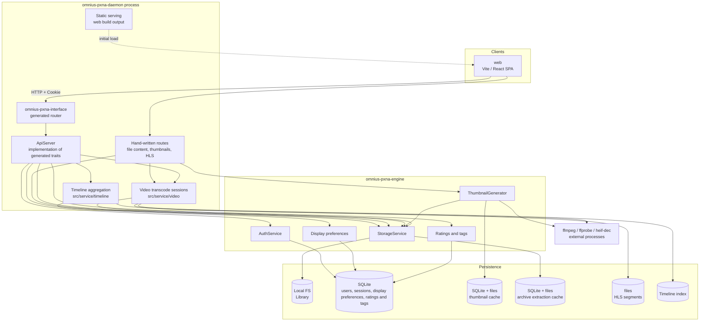
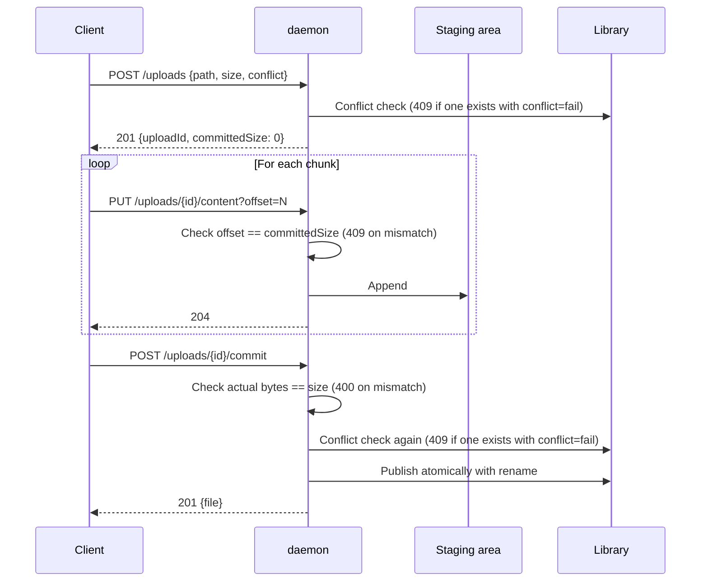
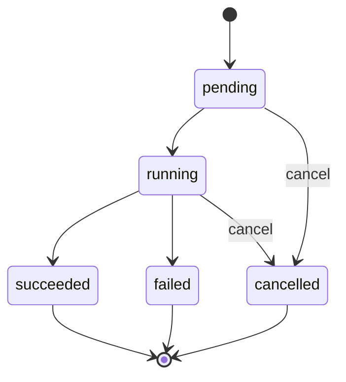

# Pxna Design

## 1. About This Document

This document describes the design of Pxna as a whole.
It covers the daemon, the engine, and the web client.

The intended readers are developers returning after some time away, and AI agents that touch this repository's code.
Build instructions for outside contributors are in `README.md`, and the specification for API users is in `daemon/openapi.yaml`.
This document assumes the vocabulary of [terms.md](./terms.md).
Definitions of words are not in this document.

### 1.1 Division of Responsibility Between Documents

| Document                                      | What it covers                                                                                                                                         |
| --------------------------------------------- | ------------------------------------------------------------------------------------------------------------------------------------------------------ |
| This document                                 | Design rationale, invariants, rejected alternatives, open issues                                                                                       |
| [Storage Layer Design](./design/storage.md)   | Driver contract, conventions for paths and entries, how archives are extracted, limits and caches, the procedure for publishing one entry              |
| [Listing and Search Design](./design/listing.md) | Sorting and filtering of listings, snapshots, name search, the name index, recursion limits                                                         |
| [Thumbnail Design](./design/thumbnail.md)     | Generating thumbnails, sprite sheets, and display images, how representative thumbnails are chosen, generation concurrency, caches                      |
| [Video Playback Design](./design/video.md)    | Media info for images and videos, direct playback, HLS transcoded delivery and transcode sessions                                                       |
| [Client Design](./design/client.md)           | Screen structure of the web client, behavior of tiles and the viewer, how thumbnails and listings are requested, Entry operations, display preferences |
| [Timeline Design](./design/timeline.md)       | What is listed in the timeline, timeline dates, the timeline index, aggregation and reading                                                              |
| [Rating and Tag Design](./design/rating-tags.md) | What can be rated and tagged, value rules, storage, following changes, filtering listings, API conventions                                          |
| [terms.md](./terms.md)                        | Definitions of terms, spelling, aliases, boundaries with neighboring terms                                                                              |
| [issues.md](./issues.md)                      | Clear defects confirmed in code and handling policies                                                                                                    |
| [knowledge.md](./knowledge.md)                | Facts verified about the libraries and external components depended on                                                                                   |
| [plans.md](./plans.md)                        | Work in progress and dependencies                                                                                                                        |
| [measurements.md](./measurements.md)          | Measurement records specifying commits and environments, comparison procedures, aggregate values, measurement conditions and limits                      |
| [reviews.md](./reviews.md)                    | History of reviews and transcription status of findings                                                                                                  |
| [Rust Coding Conventions](./coding/rust.md)  | The shape of Rust code, the reasons, check methods, how to make exceptions                                                                               |
| [daemon/openapi.yaml](../daemon/openapi.yaml) | API paths, parameters, schemas, status codes                                                                                                             |
| [README.md](../README.md)                     | Setup procedure and dependent packages                                                                                                                   |

This document does not hold an exhaustive list of API paths or status codes.
Writing it in both places would leave it unclear which is authoritative when the specification moves.
The exception is limited to conventions whose whole can be grasped only in table form, such as "Determining sync and async".
Confirmed defects go in [issues.md](./issues.md) and are not copied into this document.

### 1.2 Tense of This Document

§1 through §11 describe the completed architecture in the present tense.
The gap between the implementation status and the completed form is gathered in §12.
If you want to know what works now, read §12 first.

## 2. What Pxna Is

Pxna is a remote file manager for browsing and operating on files placed on a server from a browser.

The demand this software addresses is wanting to browse and manage files on a home server quickly from a smartphone app.
It started from the fact that looking at an existing NAS directly from a phone over SMB is heavy and slow.

The way it solves this is to generate reduced thumbnails on the server and show those lined up to the client.
The client can draw a listing without reading the original files.
It targets both images and videos, and for videos it extracts multiple frames so they can be flipped through on a tile.
An opened image is shown as a display image that the server shrinks for the screen, and a video in a format the client cannot play is delivered while the server converts it.

Why this is needed now can be explained by contrast with a NAS and Google Photos.
A NAS is heavy and slow with direct access over SMB, and vendor-provided dedicated clients offer a limited viewing experience on phones.
Google Photos does not target assets on a home server and presupposes that files are entrusted to the cloud.
By using the assets on the home server as they are, it meets both the demand of not entrusting home files to the cloud and the demand of avoiding capacity limits and cost.

The assumed operation is as follows.

- One server, one owner
- Exposed in plaintext HTTP on a LAN, and reached from outside the LAN only through a VPN such as Tailscale
- Mainly a large number of files including images, emphasizing thumbnail display and browsing inside archives

### 2.1 Out of Scope

The following have been decided not to be built.

- Shared use by multiple users, share links, invitations
- File versioning, trash, undoing deletion
- Synchronization or replication with other hosts
- Full-text search, metadata indexes for search
- Integration with general cloud storage (such as Google Drive)
- SMB compatibility
- Video editing
- Image processing
- TLS termination and certificate management

By excluding these, we avoid having a permission model, restoring deletions, maintaining index consistency, resolving cloud sync conflicts, an SMB compatibility layer, an operation system for editing and processing, and issuing and renewing certificates.
For the timeline (§6.3), aggregation builds a timeline index that holds only the timeline dates of images and videos.
The same walk also updates a name index that holds only the names of Entries, for subtree search (§8.9).
Neither index is used for full-text or metadata search, and external changes are reflected in the next aggregation, so they do not always keep consistency with the actual files.
When deciding to widen the scope, first read the deferred items in §11.2.
Some of them even state the conditions for "when to decide".

## 3. Overall Structure

### 3.1 Components and Directory Map

| Directory                                                         | Crate / package         | Role                                                                                       |
| ----------------------------------------------------------------- | ----------------------- | ------------------------------------------------------------------------------------------ |
| [daemon/entrypoints/daemon](../daemon/entrypoints/daemon)         | `omnius-pxna-daemon`    | The executable binary that handles loading configuration, starting the HTTP server, and API handlers |
| [daemon/entrypoints/interface](../daemon/entrypoints/interface)   | `omnius-pxna-interface` | The axum router and models generated from `openapi.yaml`, not edited by hand               |
| [daemon/modules/engine](../daemon/modules/engine)                 | `omnius-pxna-engine`    | Domain logic that handles file operations, thumbnails, and authentication                  |
| [daemon/refs/core-rs](../daemon/refs/core-rs)                     | `omnius-core-*`         | Foundation shared with other projects (git submodule)                                      |
| [ui-web](../ui-web)                                               | `pxna` (Vite, React)    | The web client the daemon serves statically                                                |
| [daemon/openapi.yaml](../daemon/openapi.yaml)                     | none                    | The authoritative HTTP API contract that the daemon and all clients refer to               |

`daemon/config/` is the place for development configuration and state.
The production default is `~/.config/pxna` (overridable with `PXNA_DAEMON_CONFIG_DIR`).

### 3.2 Request Flow



The web client is served from the same process and the same port as the daemon.
In other words, the API and the origin match.
This premise is what makes the CSRF protection in §8.5 hold.

Only the responses for file content, thumbnails, and HLS are returned by hand-written routes that do not go through the generated router (§11.1).
This is because the generated router cannot return the response body as a stream or vary the response's `Content-Type` according to the request.
Authentication and Library boundary checks go through the same daemon-layer processing as other paths.
ffmpeg, ffprobe, and libheif's heif-dec are not linked into the daemon and are started as external processes.
ffmpeg decodes HEIC/HEIF and the other ffmpeg-read images; heif-dec is used for images with alpha and as a fallback.

## 4. Internal Structure of the Daemon

### 4.1 Three-Layer Structure

The daemon is divided into three layers.

```
omnius-pxna-interface   HTTP input and output (generated, do not touch)
        ↓
omnius-pxna-daemon      Authorization, Library boundary resolution, delegation to the engine, error conversion
        ↓
omnius-pxna-engine      Domain logic for file operations, thumbnails, authentication
```

The engine does not know HTTP.
It does not know `libraryId` either.
What the engine receives is a resolved `NestedPath`.

The daemon layer resolves a Library-relative path to the actual location and checks that it has not left the Library.
If the engine had the check, every engine method would need to know the concept of a Library.

Inside the daemon layer, the code is divided into `src/interface/`, which handles HTTP input and output, and `src/service/`, which handles processing per Library.
`src/service/` returns the types of the generated `models`, but does not refer to the types or router of `src/interface/`.

| Location                                | What it covers                                                                                                                              |
| --------------------------------------- | ------------------------------------------------------------------------------------------------------------------------------------------- |
| `src/` top level                        | Startup and shutdown, loading configuration, assembling `DaemonState`, connecting to SQLite, the crate-wide error and its mapping in §4.4    |
| `src/interface/`                        | Processing independent of tag: assembling `ApiServer` and the router, session matching, `Origin` checks, serving the web build output        |
| `src/interface/features/<tag>.rs`       | The implementation of the generated trait for one tag of `openapi.yaml`, and conversion to that tag's response types                         |
| `src/interface/features/<tag>/route.rs` | That tag's hand-written routes, which respond ahead of the generated router                                                                  |
| `src/service/`                          | Resolving Library paths, listings and snapshots, mutating operations, uploads, Operations, video transcode sessions                          |

`interface/features` is split by tag because the generated traits are split by tag, so that when the API changes, the file to fix can be found from the tag.
Hand-written routes are placed under the same tag so that the uncalled implementation of §4.2 and the implementation that actually responds can be read side by side.

### 4.2 OpenAPI-Driven Code Generation

`openapi.yaml` is the single source of truth for the contract, and the Rust server stubs are generated from it.

```
daemon/openapi.yaml
        │  entrypoints/gen-interface.sh
        │  openapi-generator 7.23.0 / generator: rust-axum
        ↓
daemon/entrypoints/interface/   ← wiped and regenerated
        │
        ↓  implements the traits
daemon/entrypoints/daemon/src/interface/features/
```

The generated code has no dependency on the daemon, and the direction is limited to the daemon implementing the generated traits.
`gen-interface.sh` runs `rm -rf ./interface` and then generates.
Anything edited by hand in `entrypoints/interface` is lost at the next generation.

The procedure for changing the API is as follows.

1. Edit `daemon/openapi.yaml`
2. Run `daemon/entrypoints/gen-interface.sh`
3. Fix the compile errors in `src/interface/features/`

`daemon/watch-openapi.sh` is an auxiliary script that previews the specification in a browser with Scalar, and is not involved in generation.

The exception is the paths that return file content, thumbnails, and HLS playlists and segments.
The daemon holds these as hand-written axum routes (§11.1).
The contract remains written in `openapi.yaml`, and the correspondence with the implementation is kept by tests.

The generated router has routes with the same path and method, so hand-written routes cannot be added with `merge`.
We build an outer router that holds the hand-written routes and pass the generated router to it as the fallback.
The outer router passes only the requests that match no hand-written route to the generated router.
The generated trait needs an implementation of the handler for that path, so we place it as an uncalled implementation.

### 4.3 Resolving Library and Archive Boundaries

The daemon layer builds a checked `NestedPath` from `libraryId` and `RelativePath` in exactly one place.
Because this boundary is settled before being passed to the engine, the engine does not know about Libraries.

The procedure is as follows.

1. Normalize the `RelativePath` and remove `.` and `..`, and treat a remaining `..` and absolute paths as `InvalidRequest`
2. `stat` the full path joined with the Library root, and if it succeeds, settle it as rank 0 with no boundary
3. Only on `ENOENT` or `ENOTDIR`, `stat` one segment at a time from the start, and take the first thing that is not a directory as the boundary
4. Recurse the same procedure on the remaining segments inside the boundary against that archive's index
5. If the number of boundaries exceeds `max_nested_depth`, return `LimitExceeded`

A file and a directory with the same name cannot exist in the same directory, so this search has no ambiguity.
An ordinary local path is settled with one `stat` in step 2, and only paths that include an archive pay the cost of the search.

The search result is not cached.
This is because the position of a boundary does not show in the size and modification time, and a change that replaces an archive of the same name with a directory cannot be detected by invalidation checks.

The target of the Library boundary check is limited to the `..` and absolute paths the client sent.
We do not check for departures from the Library via symlinks on the file system.

### 4.4 Error Model and HTTP Mapping

The engine and the daemon each have an `ErrorKind` and implement `omnius_core_base::error::OmniError`.
They keep a backtrace and chain causes through `source`.

The `ErrorKind` exposed in the API is defined separately from the internal one.
If internal classifications (such as `DatabaseError` and `ImageError`) were exposed as they are, implementation circumstances would leak into the contract.

The mapping between the API's `ErrorKind` and HTTP status is as follows.
The individual definitions and the authoritative responses are in `daemon/openapi.yaml`.

| API `ErrorKind`       | Status | Main sources                                                                                                                           |
| --------------------- | ------ | -------------------------------------------------------------------------------------------------------------------------------------- |
| `InvalidRequest`      | 400    | Invalid path, commit of an incomplete upload                                                                                           |
| `UnsupportedType`     | 400    | Cannot be opened as an archive, corrupt, an unsupported entry kind                                                                     |
| `LimitExceeded`       | 400    | Exceeding limits such as entry count, block size, and nesting depth                                                                    |
| `Unauthorized`        | 401    | Unauthenticated, session expired                                                                                                       |
| `Forbidden`           | 403    | A change to a `readonly` Library, a change inside an archive                                                                           |
| `PasswordRequired`    | 403    | Password-protected archive                                                                                                             |
| `NotFound`            | 404    | No target, no parent folder, an expired operation                                                                                      |
| `Conflict`            | 409    | An existing conflict with `conflict=fail`, chunk offset mismatch, non-recursive deletion of a non-empty folder, an archive changing during processing |
| `AlreadyInitialized`  | 409    | `POST /setup` when the owner is already registered                                                                                     |
| `PayloadTooLarge`     | 413    | A one-shot PUT over 32 MiB                                                                                                             |
| `RangeNotSatisfiable` | 416    | `Range` is out of range                                                                                                                |
| `InsufficientStorage` | 507    | Insufficient capacity at the write destination                                                                                         |
| `Timeout`             | 504    | Exceeding the deadline for extracting an archive or generating a thumbnail with ffmpeg                                                 |
| `InternalServerError` | 500    | Anything else                                                                                                                          |

The reasons for making `UnsupportedType`, `LimitExceeded`, and `PasswordRequired` independent kinds, and for returning `Timeout` as 504, are recorded in §11.1.
The engine's `Cancelled` is not in the table and falls to `InternalServerError`.

## 5. Storage Layer

This is the layer that actually reads and writes the contents of a Library.
The entry point is `StorageService`, which receives a `NestedPath` and dispatches the host file system and read-only archives to the same driver contract.
Making the inside of an archive feel the same as a folder is this layer's job.

The boundaries with other concerns are decided by the following three points.

- The daemon layer builds a `NestedPath` from a `RelativePath`, settles the Library boundary and archive boundaries, and then passes it on (§4.3)
- What the storage layer has is only the operation of reading one entry and the operation of safely placing one entry
- Walking trees, applying conflict per entry, progress reporting, and cancellation belong to the Operation layer of the mutating APIs (§8.3)

**What supports the higher-level contracts is the guarantee that only the publication of one file is atomic.**
Neither a one-shot PUT, an upload session, nor a copy leaves a half-finished file at the target path when a request is cut off midway.
Conversely, atomicity and rollback of a whole directory tree are not guaranteed.
A tree copy that fails midway leaves the folders already created and the files already copied.

The mechanism that makes this guarantee hold, and the conditions under which it breaks, are covered by [Storage Layer Design §5.3](./design/storage.md#53-write-operations-and-stagingfile).

The driver contract, limits, caches, how archives are extracted, handling of symbolic links, how staging is placed, and the reasons for adopting these and the limits of the guarantees are authoritative in [Storage Layer Design](./design/storage.md).

## 6. Thumbnails and Video

### 6.1 Thumbnails

`ThumbnailGenerator` generates and caches a thumbnail from the requested Entry.
It shrinks images, extracts multiple frames from videos with ffmpeg to make a sprite sheet, and returns the first image or video among the direct children of a folder or archive as the representative thumbnail.
The display image the viewer shows first is also generated by the same path.

Generation is done only when a client request arrives, and there is no bulk background generation.
Which tile to generate first is decided by the client through the order of requests and cancellation, and the server processes them in arrival order.
The cache is held as a SQLite index plus real files, and managed by an LRU with separate capacity budgets for thumbnails and display images.

The rules of generation, the cache keys, the configuration, and the reasons for adoption are authoritative in [Thumbnail Design](./design/thumbnail.md).
Which tiles the client requests and when is covered by [Client Design §4](./design/client.md#4-thumbnail-requests).

### 6.2 Video Playback

For a video opened in the viewer, the server returns the media info it examined with ffprobe, and the client chooses between direct playback and transcoded playback.
In direct playback, the content API returns the original file as a stream.
In transcoded playback, the server delivers while converting to HLS with H.264 and AAC using ffmpeg, and when a seek goes to a position away from the one being converted, it restarts ffmpeg.

The transcode sessions, output, concurrency, configuration, and reasons for adoption are authoritative in [Video Playback Design](./design/video.md).

### 6.3 Timeline

The timeline lists the images and videos of the chosen Libraries in one sequence in descending order of timeline date, decided from the shooting date and time (or else the modification time), without folder hierarchy.
The daemon aggregates each Library periodically, writes the timeline dates to the timeline index, and answers page requests from the web client from the index.
Images and videos inside archives are also extracted and their timeline dates read, and the extraction for aggregation is done in a concurrency budget separate from browsing.
The daemon's own mutating operations immediately reflect only the range they changed in the index.

What is listed, the timeline date, the index, aggregation, the configuration, and the reasons for adoption are authoritative in [Timeline Design](./design/timeline.md).
The screen and how it loads are covered by [Client Design §3.10](./design/client.md#310-timeline).

### 6.4 Ratings and Tags

A user can give the images and videos they have seen a good or bad rating and tags of free words.
Ratings and tags do not change Entries and are saved per user in `sqlite.db`, so they can be given even in a `readonly` Library.

What can be rated or tagged, the value rules, storage, following changes made through Pxna, filtering listings, and the reasons for adoption are authoritative in [Rating and Tag Design](./design/rating-tags.md).
The operations of rate mode and the info panel are covered by [Client Design §3.4](./design/client.md#34-viewer) and [§3.8](./design/client.md#38-info-panel).

## 7. Authentication and Sessions

### 7.1 Initial Setup

The daemon starts out with no users existing.

- `GET /setup/status` returns `initialized: false`
- `POST /setup` registers the first owner
- After that, `POST /setup` returns 409

Checking existence and creating the user must be done atomically.
Otherwise, concurrent requests could create two owners.
Within a single SQLite `INSERT` statement, we insert on the condition that no user exists, and decide which request won by the number of rows inserted.

Until the owner is registered, `POST /setup` accepts the first request regardless of its source (the reason is in §11.1).

`UserRole` defines only `owner`.
It is a single-element enumeration so that no schema change is needed if roles are added in the future.

### 7.2 Sessions

Authentication is by username and password, and on success a session is created on the server side.
Neither JWTs nor refresh tokens are used.

The client chooses between two ways of receiving it (`SessionTransport`).

| transport | Carried by                                                                        | Stored in                 |
| --------- | --------------------------------------------------------------------------------- | ------------------------- |
| `cookie`  | `__Host-pxna_session` cookie (`Path=/`, `HttpOnly`, `Secure`, `SameSite=Strict`) | The browser               |
| `bearer`  | `Authorization: Bearer <opaque>`                                                  | Native clients            |

Both are opaque identifiers pointing to the same server-side session, and the substance is the same.
The difference is only the means of carrying it, and the behavior of the file API does not change.

`DELETE /auth/session` expires the session.
For a cookie client, it also returns an expired cookie.
A bearer client is responsible for deleting the token from its store after confirming success.

The session token is 32 bytes of random data and appears in plaintext only when handed to the client.
SQLite stores only the token's SHA3-256, and the lookup uses the value obtained by passing the request's token through the same function.
Passwords are stored hashed with argon2id.
Both are so that no value remains from which one could log in directly if `sqlite.db` leaks (§11.1).

A session expires 30 days after creation, and the token of an expired session gives 401.
It is not extended.
The last-used time (`lastSeenAt`) is written not on every request but only when 5 minutes or more have passed since the previous record.
This is because writing to SQLite on every request would make writes increase in step with the number of requests when requests concentrate, such as when listing thumbnails.

When a login fails, the same 401 is returned both when the username does not exist and when the password is wrong.
Even when the username does not exist, a dummy hash is verified, to make it hard to infer whether a username exists from the response time.

## 8. Conventions for Mutating APIs

This section gathers the mutating conventions scattered across `openapi.yaml` from the viewpoint of judgment.
For individual paths and schemas, see `openapi.yaml`.
API paths in this document are written relative to the server base `/api/v1`, such as `/libraries/{id}/files/...`.

### 8.1 Namespaces

Files and folders have separate namespaces.

```
/libraries/{id}/files/...
/libraries/{id}/folders/...
```

Depending on the kind of target, the meaning of the non-empty check and of recursion changes.
If they were combined into one endpoint, which validation to apply would not be decided until the request's contents were examined.

When operating on a mixed multiple selection, the client splits it into two requests by kind.

An archive's path points to different things depending on the namespace.
In the `folders` API (including listings and subtree search) it points to the root inside the archive, and in the `files` API it points to the archive's file itself.
This is so that, at the same path, one can both list its contents and download, copy, or delete it as a file.

### 8.2 Determining Sync and Async

There is one criterion: **whether the time taken is proportional to the content size or to the number of entries**.
Those that are not proportional respond synchronously, and those that are proportional return `202` and `{operation}`, with the identifier carried in `operation.id`.

| Operation                   | Condition                                          | Response |
| --------------------------- | -------------------------------------------------- | -------- |
| Create folder               | None                                               | 201      |
| One-shot write              | None                                               | 201      |
| move (file / folder)        | Single src and the same Library                    | 200      |
| move (file / folder)        | Multiple srcs, or across Libraries                 | 202      |
| copy (file / folder)        | Always                                             | 202      |
| delete (file)               | Single src                                         | 204      |
| delete (file)               | Multiple srcs                                      | 202      |
| delete (folder)             | `recursive=false` (the target must be empty)       | 204      |
| delete (folder)             | `recursive=true`                                   | 202      |

A move within the same Library is normally a single `rename(2)`, and its duration is not proportional to the content bytes.
With `overwrite` onto an existing folder, children are renamed one at a time to merge. The processing time is proportional to the number of entries, but no byte sequences are copied.
A move across Libraries involves copying the actual content, so it is asynchronous.
The reason for deciding the path by the shape of the request alone is recorded in §11.1.

### 8.3 Conflict Policy

Copy, move, and upload take a common `conflict`.

| Value            | Behavior                                                         |
| ---------------- | ---------------------------------------------------------------- |
| `fail` (default) | Reject with 409                                                  |
| `skip`           | Do not touch the existing one, and report that source as skipped |
| `overwrite`      | Replace the existing one                                         |
| `rename`         | Write under another name and return the chosen name in the result |

The reason for making the default `fail` is recorded in §11.1.

In asynchronous operations, entry-level conflicts are handled according to `conflict`, and the results are aggregated into the `Operation`'s `skippedCount` and `failedEntries`.
The published top-level destinations are carried in `resultEntries`, and the destination Library in `destinationLibraryId`.
The name chosen by `rename` can also be obtained from this result.

**Walking the tree and applying conflicts belong to the daemon's Operation layer.**
The storage driver has only operations that target one entry.
If the whole tree were handled in a single call, none of `processedCount`, `failedEntries`, or cooperative cancellation could be extracted.
How to safely place one entry is covered by [Storage Layer Design §8](./design/storage.md#8-copy-and-move).

The meaning of tree operations targeting folders is as follows.

- `overwrite` replaces files of the same name and recursively merges into folders of the same name
- Destination entries that do not exist on the source side are not deleted
- When kinds conflict between a file and a folder, only that conflicting entry is deleted and replaced with the same kind as the source
- Even if it fails midway, the folders already created and files already copied remain. The whole tree is not rolled back
- Symbolic links and special entries found during the walk are not followed and not silently excluded, and the operation fails on that entry

For a copy where the source and destination point to the same entity, only the `rename` alias duplication is allowed. For folders, it is rejected if the parent where the alias would be created is the source itself or under it. A move to the same entity, and a copy or move to under the source folder itself, are rejected.

Only a symbolic link directly named as the copy source reads the link target.
This is because if the walk descended through links, loops and duplicates would occur, and this line is the same as the walk rule in [Storage Layer Design §4.4](./design/storage.md#44-symlinks-and-special-entries).
The handling when multiple source names correspond to the same destination on a case-insensitive file system is also covered, as a publication rule for one file, by [Storage Layer Design §8.3](./design/storage.md#83-publishing-a-file-and-resolving-conflicts).

### 8.4 Deletion

Hard delete only, with no trash.

The HTTP `DELETE` verb is not used, and it is unified into `POST /files/delete` and `POST /folders/delete` (the reason is in §11.1).

Deleting a non-empty folder requires `recursive=true` to be explicit.
It does not recurse when omitted, so there is no path by which a mistaken operation deletes a whole tree.

### 8.5 CSRF

For cookie sessions, we apply `SameSite=Strict` and `Origin` validation on mutating requests.
We do not issue or verify CSRF tokens.
As long as it is confined to the same origin, these two are enough.

The `Origin` validation is applied to all paths by a daemon layer placed outside the generated router.
When a request other than `GET` and `HEAD` has a session cookie, it returns 403 unless the host and port of the `Origin` match the `Host`.
It also gives 403 when there is no `Origin`.
If a request without an `Origin` were let through, the whole validation would be bypassed once a way to have one sent without an `Origin` was found.
Requests without a cookie (bearer requests and requests before setup and login) are not validated.

**This decision depends on the serving method in §10.1.**
If the configuration were changed to serve the web client from a different origin, this would need to be redesigned.

### 8.6 Archives and readonly

- A mutating operation on a path inside an archive is 403
- A mutating operation on a `readonly` Library is 403

A Library's `readonly` prohibits changes to the whole Library. An Entry's `metadata.readonly` is separate from the Library's setting, and a normal Entry returns `false` even inside a `readonly` Library. Entries inside an archive, and `GET /folders` that fetches the folders at an archive's root and inside it, return `metadata.readonly=true`. The archive's own file Entry is handled like an ordinary file.
The client decides whether something can be changed from the logical OR of the Library's `readonly` and the Entry's `metadata.readonly` (for creating a folder, the destination's `GET /folders`). The `kind` of the 403 for a change request is `Forbidden`.

Copy and move also check the destination side.
A copy from a readable Library to a `readonly` Library gives 403.

### 8.7 Uploads

Files of 32 MiB or less are handled by a one-shot `PUT /files/content?path=`.
Anything larger returns 413 and has the client use an upload session.

The flow of an upload session is as follows.



There are three design points.

- By having the final size declared at creation and checked at commit, we prevent committing an upload session that was cut off midway
- A chunk's `offset` must match the current `committedSize`, and a mismatch returns 409
  The client reads the correct resume position with `GET /uploads/{id}`
- The target path may become occupied between creation and commit, so the conflict check is done twice, at creation and at commit

The staging area is taken in the same directory as the target path.
The upload session appends to the same staging across chunks.
A chunk is 32 MiB or less, and a request over the limit gives 400 `LimitExceeded`.
A session that failed to append or publish becomes `aborted`, and further appends to the uncertain staging are refused.
How staging is placed, and the reason the engine's primitives were split into three stages, are covered by [Storage Layer Design §5.3](./design/storage.md#53-write-operations-and-stagingfile).

An upload session expires 24 hours after creation.
Like Operations, it is held only in memory and disappears when the daemon restarts.

### 8.8 Operations



`cancel` is a cooperative cancellation request.
Entries already processed are not rolled back.
A `cancel` on an already finished operation only returns the current state and does nothing.

Operations are held only in memory.
Restarting the daemon deletes them all, and `GET /operations/{id}` gives 404.
Completed ones are pruned after about an hour.

### 8.9 Search

Search is a listing with conditions. The search API applies name, rating, and tag conditions to the listing of each chosen Library, recursive when searching under a folder, and merges them into one sequence.
A recursive listing with conditions is answered from the name index that aggregation updates, and walks the file system only while that index is not usable.
The sorting of listings, snapshots, name matching, recursion limits, and the reasons for adopting these are authoritative in [Listing and Search Design](./design/listing.md).
How the client reads listings and search is covered by [Client Design §3.5](./design/client.md#35-loading-listings) and [§3.6](./design/client.md#36-search).

## 9. Configuration and Persistence

### 9.1 Configuration File

The configuration is TOML, and the default location is `~/.config/pxna/pxna.toml`.
It can be changed with the `PXNA_DAEMON_CONFIG_DIR` environment variable or the `--config-dir` argument.

```toml
[core]
listen_addr = "0.0.0.0:6050"
state_dir = "./state"

[logging]
level = "info"
json = false

[web]
dir = "/usr/share/pxna/web"

[[libraries]]
id = "photos"
name = "Photos"
path = "/srv/photos"
readonly = false
```

`[web] dir` is the directory of the web build output the daemon serves, and relative paths are based on the configuration directory.
If omitted, the daemon provides only the API (§10.1).
`[web] insecure_cookie = true` removes `Secure` and the `__Host-` prefix from the session cookie and makes the name `pxna_session`.
Browsers reject a `Secure` cookie over `http://` from anywhere other than `localhost`, so the plaintext operation of §2 needs it.
The daemon's default is `false`, and the template `config/pxna.toml.example`, from which `start.sh` creates the `config/pxna.toml` that `compose.yaml` mounts, sets it to `true` (§11.1).

Libraries can be defined only here.
There is no means of adding or removing a Library through the API.
Deciding the exposed scope is the authority of the server operator, not of whoever obtained an API session.

The archive's resource limits and cache capacity go in the top-level `[storage.archive]`.
The authoritative keys and defaults are recorded in [Storage Layer Design §7](./design/storage.md#7-configuration-and-cache).

The configuration of listing snapshots and recursion limits goes in `[listing]`.
The authoritative keys and defaults are recorded in [Listing and Search Design §7](./design/listing.md#7-configuration).

The thumbnail configuration (including output format and quality) goes in `[thumbnail]`, the video transcoding configuration in `[video]`, and the locations of the ffmpeg and ffprobe executables in `[media]`.
The authoritative keys and defaults are recorded in [Thumbnail Design §9](./design/thumbnail.md#9-configuration) and [Video Playback Design §6](./design/video.md#6-configuration).

The timeline's time zone and the aggregation interval and concurrency go in `[timeline]`.
The authoritative keys and defaults are recorded in [Timeline Design §8](./design/timeline.md#8-configuration).

The web client's display preferences are not put in the configuration file, and are saved in SQLite as values the owner changes from the web client ([Client Design §3.9](./design/client.md#39-display-preferences)).

At startup it takes a process lock to prevent multiple instances.

### 9.2 Where State Lives

| Location                          | Contents                                                           | Impact when lost                                                   |
| --------------------------------- | ------------------------------------------------------------------ | ------------------------------------------------------------------ |
| SQLite (`state_dir/sqlite.db`)    | Users, sessions, display preferences, ratings and tags             | Setup is needed again. Display preferences return to defaults, and ratings and tags are lost |
| `state_dir/thumbnail`             | Thumbnail cache                                                    | Regenerated                                                        |
| `state_dir/storage/archive`       | archive extraction cache                                           | Re-inspect and re-extract are needed                               |
| `state_dir/video`                 | HLS segments of transcode sessions                                 | Transcoded playback in progress is interrupted                     |
| `state_dir/timeline`              | Timeline index                                                     | Rebuilt by the next aggregation, and until it finishes, Entries to list in the timeline are missing |
| `state_dir/listing`               | Browse index and name index                                        | Summary listings are enumerated again. Recursive search walks the file system until the next full aggregation finishes |
| Staging area                      | Bytes of uploads in progress                                       | Uploads in progress are lost                                       |
| Memory                            | Operations, transcode sessions, media info, listing snapshots      | Tracking of operations and transcodes in progress is lost. Listings are rescanned on the next request |

SQLite is opened in WAL mode, and migrations are applied by name by `omnius-core-migration`.
The tables are migrated by the engine component that uses them, at construction time, not by the daemon.
This is so that engine tests can create the same tables without going through the daemon.

### 9.3 Distribution

The daemon is distributed as a Docker image.
The image is built for two architectures, amd64 and arm64, on Debian trixie, and contains the daemon's executable, the web build output, a pinned ffmpeg 9 and ffprobe, and libheif's heif-dec for images with alpha.
The daemon checks at startup that ffmpeg and ffprobe are version 9 or newer.

| What is passed in from outside the container | How it is passed |
| --- | --- |
| Configuration directory | A volume. `PXNA_DAEMON_CONFIG_DIR` points to its location inside the container |
| `state_dir` | A volume. It holds the locations in §9.2 together |
| Library | A bind mount. The configuration's `path` is written as a path inside the container |
| The listening port | Publish the port of `listen_addr`. `compose.yaml` publishes it on the address of `PXNA_BIND`, `127.0.0.1` by default (§11.1) |

The container starts as a user with UID and GID 10001.
The configuration directory is passed in writable by this user for creating the lock, and state and writable Libraries for saving.
The web build output is placed at `/opt/pxna/web` inside the image.

CI builds and smoke-tests on native runners for both architectures.
On a push to main, after both are verified, it publishes the `latest` and commit-SHA manifests of `ghcr.io/omnius-labs/pxna`.

The image includes ffmpeg, so operators do not need to install ffmpeg separately.
When using a hardware encoder, the operator passes the device to the container and changes the encoder setting in `[video]` ([Video Playback Design §5.3](./design/video.md#53-output)).

## 10. Clients

The screen structure, the behavior of tiles and the viewer, and how thumbnails are requested are authoritative in [Client Design](./design/client.md).
This chapter holds only the serving method, the handling of sessions, and constraints common to clients.

### 10.1 Web

The web client is a React SPA built with Vite, and the daemon serves it from the same port (the reason is in §11.1).
It has no server-side rendering, and the web client is a client-side application that only calls the API.

For paths not starting with `/api/`, the daemon returns static files from `[web] dir` (§9.1), and if there is no matching file it returns `index.html`.
The web client represents the current position with the URL path ([Client Design §3.1](./design/client.md#31-web)), so reloading such a URL returns to the same screen.
For paths starting with `/api/`, even when no route matches, it does not return `index.html` but returns the API's 404.
This is so that a mistaken API call does not look like a success as an HTML 200.

During development, Vite's dev server forwards `/api` to the daemon, keeping the origin as seen from the browser to one.
The forwarding destination defaults to `http://localhost:6050` and can be changed with the environment variable `PXNA_DAEMON_ORIGIN`.
The forwarding does not rewrite `Host`.
The `Origin` validation in §8.5 compares `Origin` with `Host`, so if `Host` were rewritten to the daemon's listening address, mutating requests with a cookie would give 403.

### 10.2 Constraints Common to Clients

- A location is always pointed at with `libraryId` and a Library-relative path, and the host's absolute path is never assembled
- The roots to display are limited to the range `GET /libraries` returns, and no UI is built to walk above it
- Fetching a large file uses `Range`, and does not put the whole in memory
- Uploads over 32 MiB go through an upload session

## 11. Design Decisions

### 11.1 Decided

#### Hide Host Paths Behind the Library Abstraction

**Decision**
The API points to a location with the pair of `libraryId` and a Library-relative path.
Absolute paths on the host are not included in responses.
The exposed scope is decided only by the configuration file.

**Reason**
If arbitrary paths are not accepted from the client, the traversal check is done in one place, at the Library boundary.
The unit of `readonly` also rides on this.

**Rejected alternative**
A method in which the client specifies the root path.
The previous implementation took this form, and the server did not constrain the root to permitted directories.
It would scatter the checks across all handlers, and a miss in one place would become a hole in the whole, so we rejected it.

#### Represent Archive Nesting with NestedPath

**Decision**
The engine's internal path is represented as a single string `NestedPath` delimited by `\0`.
`StorageService` switches the filesystem at each delimiter and passes the driver a `&str` within one filesystem.
The limit on archive boundaries is given by the configuration value `max_nested_depth` (the default is in [Storage Layer Design §7.2](./design/storage.md#72-defaults)).

**Reason**
`\0` does not appear in a path component on any major OS.
Used as the delimiter, original path strings can be concatenated as they are without escaping.
Limiting the depth makes the recursive materialization of an archive bomb finite.
We made it a configuration value, not a fixed one, because this limit has no design basis and means nothing beyond stopping runaway behavior.

#### Represent Paths Inside Archives by Joining Paths

**Decision**
Paths inside archives in the API are joined like `/photos/a.zip/dir/x.png`, and the grammar of `RelativePath` is not changed.
The position of the boundary is decided by the daemon layer by searching the file system (§4.3).

**Reason**
Alternatives other than joining can express the request but break the response.
The path of an entry returned by a listing inside an archive becomes a "pair of local path and inner path", and everything from the listing response to the paths of failed entries and link targets becomes a composite key.
With joining, the path stays a single string, and the shape of the API does not change however deep the nesting goes.

The concern that "it cannot be distinguished from a folder named `a.zip`" does not hold.
A file and a directory with the same name cannot coexist in the same directory in POSIX or NTFS, and likewise on case-insensitive file systems.

**Rejected alternative 1**
An `innerPath` query parameter, or a dedicated archive endpoint.
In addition to the response-side breakage above, an array parameter would be needed once the depth became variable, so we rejected it.

**Rejected alternative 2**
Introducing a delimiter such as `!` into `RelativePath`.
It would bring an escape grammar into the grammar of paths, so we rejected it.

#### Limit the Library Boundary Check to Client Input

**Decision**
The targets of the Library boundary check are limited to the `..` and absolute paths contained in the `RelativePath` the client sent (§4.3).
We do not check for departures from the Library via symbolic links on the file system.

A link target is put in a response only when it can be resolved to a Library-relative path, and is not put in when it points outside the Library or is broken.
This is so that the host's absolute path is not included in responses (§4.1).

**Reason**
Only the owner can place symbolic links on the file system, and the API has no path to create them.
What corresponds to an attacker is the client side, so it is enough to doubt only strings coming from there.
This line also avoids breaking the real-world configuration of a Library that bundles external disks with symbolic links.

The rules on the side that follows them are covered by [Storage Layer Design](./design/storage.md#follow-local-symlinks-and-do-not-follow-symlinks-inside-archives).

**Rejected alternative**
Always requiring that the `canonicalize`d result is under the Library root.
A link pointing to an external disk points exactly outside the Library, so this would block the main use.

#### Represent "Is an Archive" in File Detail, Not in the Kind

**Decision**
`FileSystemEntryKind` classifies an [Entry in terms.md](./terms.md#t-entry) into `file` / `folder` / `link`, and whether one can go inside is expressed by the `archive` flag placed in the `file` detail.
The basis for the determination is the extension alone.

**Reason**
If archive were a kind, every determination on a "treat as a file" path, such as download, copy, move, delete, and filtering by `kind`, would miss zips.
An archive is a subtype of file, not a kind alongside file.

We fixed the basis to the extension so that the same rule can be used in listings inside an archive too.
If we tried to settle it by signature, each entry would have to be extracted every time the inside of an archive is listed, and the basis of the determination would differ between outside and inside.
The set of supported extensions is a property of the server, so the client is not made to hold the same list.

**Rejected alternative**
Adding `archive` to `FileSystemEntryKind`.
Every determination written as `kind == file` would miss zips, so we rejected it.

#### Expose Archive-Specific Error Kinds in the API

**Decision**
We add `UnsupportedType`, `LimitExceeded`, and `PasswordRequired` to the API's `ErrorKind` (§4.4).

**Reason**
These three are not implementation circumstances but user-visible facts about the target file.
The client needs to show separate messages for "this format cannot be opened", "too large", and "password protected".

**Rejected alternative**
Pushing them into existing kinds and carrying the details in `message`.
The client would branch by parsing the wording, and it would break whenever the wording is fixed, so we rejected it.

#### Run OpenAPI Spec-First

**Decision**
We write `openapi.yaml` by hand and wipe and regenerate `entrypoints/interface` from it.
The generated output is not edited by hand.
Only the paths for file content, thumbnails, and HLS have the contract written in `openapi.yaml` and are implemented by hand-written routes ("Return file content responses as streams" and "Return thumbnail responses outside the generated router").

**Reason**
The API is the contract between the server and the two kinds of clients, and we want it placed above Rust types.
If the specification is derived from code, the contract cannot be discussed without changing the Rust implementation.

**Rejected alternative**
Code-first generation with `utoipa`.
We introduced it once, but rejected it because the contract's home becomes subordinate to the server implementation.

#### Authenticate with Server-Side Sessions, Not JWT

**Decision**
We authenticate with username and password and refer to a server-side session with an opaque identifier.
We provide two paths, cookie and bearer, but the substance is the same session.

**Reason**
We prioritized being able to expire immediately.
In a configuration with a single owner and a single server, there is no benefit in handing out tokens that cannot be expired.

**Rejected alternative 1**
JWT and refresh tokens.
Server-side state ends up being needed anyway to expire them, and the benefit of being stateless disappears.

**Rejected alternative 2**
A challenge-response handshake with a QR code and one-time token.
It was adopted in the earlier TCP-based design.
Once we moved toward HTTP and OpenAPI, there was no longer a reason to maintain a proprietary protocol.

#### The First Registrant Becomes the Only Owner

**Decision**
We accept `POST /setup` only while no user exists, and return 409 afterward.
Checking existence and creating are done atomically.

Until the owner is registered, the first `POST /setup` is accepted regardless of its source.

**Reason**
With the smallest implementation, we can close the path by which someone else becomes the owner after the owner is registered.

The window before registration is open to all devices on the LAN.
The operating premise of §2 treats devices on the same network as trustworthy, and the window is open only from the first start of the daemon until the owner is registered.
We judged that it does not justify the cost of a mechanism to close the window.

**Rejected alternative 1**
A method that prints a one-time setup token to the log at startup and requires it in `POST /setup`.
Only an operator who can read the log can register, but it adds entering a token to the requirements of `openapi.yaml` and the web client's first screen, and rules for reissuing the token are also needed, so we rejected it.

**Rejected alternative 2**
A method that limits `POST /setup` to connections from loopback.
With Docker (§9.3), the basis of distribution, even connections from a browser on the host do not look like loopback from inside the container, so we rejected it.

#### Store Passwords and Session Tokens Only as Hashes

**Decision**
Only the value mapped with argon2id for passwords and with SHA3-256 for session tokens is stored in SQLite (§7.2).

**Reason**
`sqlite.db` can leave the daemon through backups and copies.
If plaintext tokens remained, whoever read them could log in as the owner as is.
The reason a slow hash is used for passwords is to slow down brute force from leaked hashes.
A token is 32 bytes of random data and is not a target of brute force, so the fast SHA3-256 suffices.

**Rejected alternative**
Hashing passwords with `ring`'s PBKDF2-HMAC-SHA256.
It avoids adding dependencies, but it lacks the property of making parallel brute force on GPUs slower by forcing heavy memory use, so we chose argon2id.

#### Decide Sync and Async by the Shape of the Request

**Decision**
Only operations whose duration is proportional to the content size are asynchronous (the table in §8.2).
Operations that are not proportional return synchronously.

**Reason**
The client can predict which path it will take before receiving the response.
If a rename within the same Library required polling an operation, a rename of a name would take two round trips.

#### Make the Default conflict `fail`

**Decision**
We make the default value of `conflict` `fail`, and reject with 409 if one already exists.

**Reason**
Overwriting is done only when explicitly requested.
If the default is destructive, an implementation that forgot to attach the parameter deletes data.

**Rejected alternative**
The engine's `TransferOptions` originally had three options, `Skip` / `Overwrite` / `Rename`, with no option to reject.
It was a design that "always does something on conflict", and could not express a safe default, so we rejected it.

#### Delete Is a Hard Delete, Unified on POST

**Decision**
There is no trash.
We unify on `POST /files/delete` and `POST /folders/delete` and do not use the `DELETE` verb.
We require `recursive=true` for non-empty folders.

**Reason**
A trash would mean implementing undoing deletion, which falls under the out-of-scope items in §2.1.
Batch deletion needs a body with an array of targets.
Attaching a body to `DELETE` is handled inconsistently by intermediary software.

**Rejected alternative**
The `DELETE /files?path=` form.
It can express only single deletion and would create a double path alongside batch.

#### Archives Are Read-Only

**Decision**
Mutating requests to paths inside archives are rejected with 403.

**Reason**
Like a `readonly` Library, it means "that is a resource that cannot be written", so it is expressed with the same kind and the same status.
Appending to an archive involves rebuilding the whole thing, depending on the format.
If it fails midway, the whole archive is broken, so inside archives we cannot satisfy the guarantee of §5 of "not leaving a half-finished state at the target path".
A copy from an archive to local is allowed because it is a composition of reading and a new publication on the local side.

The storage layer's driver also performs the same rejection a second time.
The reason and the rejected alternative are covered by [Storage Layer Design](./design/storage.md#explicitly-reject-archive-mutation).

#### Serve the Web Client Statically from the Same Origin

**Decision**
We make the web client a React SPA built with Vite, and the daemon serves it from a configured directory on the same port as the API (§10.1).

**Reason**
CORS becomes unnecessary and `SameSite=Strict` cookies can be used as is.
The distribution does not need to include a Node runtime, and the daemon can be shipped as one process and one image (§9.3).

The web client is a client-side application that only calls the API, and it represents locations decided at runtime in the URL path.
With an SPA, that form can be supported by just the daemon's fallback to `index.html`.

We read the build output from a configured directory instead of embedding it in the executable so that building and checking the daemon do not depend on Node.

**Rejected alternative 1**
A configuration that runs `next start` as a separate process.
It becomes cross-origin and CORS and CSRF would have to be redesigned.
Operation would also be two processes.

**Rejected alternative 2**
A configuration that statically exports Next.js.
We once placed it as the scaffold from create-next-app.
With static export, locations decided at runtime cannot be dynamic routes, and the location would be held in the query string.
SSR, Server Actions, and Route Handlers are also unusable, so no benefit of choosing Next.js remains, and we rejected it.

**Rejected alternative 3**
A configuration that puts nginx in front of the daemon, with nginx handling static serving and forwarding `/api`.
The daemon would no longer have static-serving code, but there would be two images and two processes.
nginx's defaults such as the body size limit, response wait time limit, response buffering, and rewriting `Host` each collide with uploads, waiting for archive extraction, streamed responses, and the `Origin` validation in §8.5.
Mistakes in those settings cannot be detected by the daemon's tests, so we rejected it.
A configuration that optionally puts a reverse proxy in front to terminate TLS is rejected in "Leave Encryption to the Network and Serve Plain HTTP".

**Rejected alternative 4**
A configuration that embeds the web build output in the daemon's executable.
The distribution would be a single file, but the web build is needed before the daemon build, and the Rust build and CI would depend on Node, so we rejected it.

#### Validate Library ids at Startup

**Decision**
We restrict a Library's `id` to `^[A-Za-z0-9._-]{1,64}$`, validate it at startup, and abort startup if it is invalid.

**Reason**
The `id` is used as a URL path segment.
For a configuration mistake, failing before startup makes the cause easier to trace than running with broken routing.

#### Compare Name Order in Natural Order

**Decision**
For name-order sorting, a name is split into runs of digits and everything else; runs of digits are compared as numbers, and the rest is compared without distinguishing case.
Names that are still equal are decided by byte order.
The name order of listings and the selection of the representative thumbnail ([Thumbnail Design §5](./design/thumbnail.md#5-representative-thumbnails)) use the same comparison.

**Reason**
Sequentially numbered file names are sometimes given without aligning the digits, and in byte order `10.jpg` comes before `2.jpg`.
For sequentially numbered images in an archive, the order of the cover and the spreads breaks.
Deciding last by byte order is to make the order of the same folder identical every time, and to keep the representative thumbnail selection and the order of a rebuilt listing snapshot from changing.

**Rejected alternative**
Comparing in byte order.
The current code's name order takes this form, but we rejected it because the order of sequential numbers breaks.

#### Return Extraction and Generation Deadline Expiry as 504

**Decision**
The engine's `Timeout` is returned as the API's `ErrorKind` `Timeout` with 504.
`Retry-After` is not attached.
The engine's `Cancelled` stays as `InternalServerError` with 500.

**Reason**
The web client displays that archive extraction and thumbnail generation exceeded their deadline separately from other failures.
The deadline is `extract_timeout_secs` for extraction ([Storage Layer Design §7.2](./design/storage.md#72-defaults)), and the per-run deadline of ffmpeg for generation ([Thumbnail Design §6.3](./design/thumbnail.md#63-failure-and-timeout)).
We chose 504 to express that the daemon could not wait for external processing (archive extraction and ffmpeg) up to the deadline.

The result of an extraction that passed the deadline is not registered in the cache, so repeating the same request can hit the same deadline expiry.
This is why we do not attach `Retry-After`, which would encourage retrying.

`Cancelled` occurs only from a requester's disconnection or the daemon's stopping, and there is no client to receive the response, so we do not add a kind.

**Rejected alternative 1**
Leaving `Timeout` as `InternalServerError` with 500.
The API would not change, but the client could not distinguish a deadline expiry from a defect, so we rejected it.

**Rejected alternative 2**
Returning `Timeout` as 503.
It would mean temporarily unavailable, which does not fit the fact that retrying can hit the same deadline expiry, so we rejected it.

#### Return File Content Responses as Streams

**Decision**
The file content response and HLS playlists and segments are returned by hand-written axum routes that the daemon places outside the generated router, and the body is streamed (§4.2).
The contract remains written in `openapi.yaml`, and the correspondence with the implementation is kept by tests.

**Reason**
The generated interface receives the response body as a `Vec<u8>`, so it would read the whole requested range into memory before returning.
For direct video playback and fetching large files, the amount returned in one response can exceed several hundred MB.
With a hand-written route, it can stream without accumulating in memory, and an ordinary browser download without `Range` also works as is.

**Rejected alternative 1**
A method that replaces the generator's templates so that streams can be returned within the generated path.
No hand-written route arises, but the templates would have to be kept up with each time the openapi-generator version is raised, so we rejected it.

**Rejected alternative 2**
A method that lowers the per-response limit and has the client fetch in pieces with `Range`.
Video players can handle it, but a browser download without `Range` could fetch only the beginning, so we rejected it.

#### Return Thumbnail Responses Outside the Generated Router

**Decision**
Like file content, thumbnail responses are returned by a hand-written axum route placed outside the generated router (§4.2).
The contract remains written in `openapi.yaml`.

**Reason**
The thumbnail output format can be chosen from WebP, JPEG, and PNG, but the generated router fixes the response's `Content-Type` to the first type listed in the contract.
With the generated router as is, a response returning a format other than the first type would carry a wrong `Content-Type`.
With a hand-written route, the `Content-Type` of the format actually returned can be attached.

**Rejected alternative 1**
A method that makes the output JPEG only and abolishes `format`.
The `Content-Type` problem disappears, but PNG output that keeps transparency would be lost and the margin of `pad` would be filled with an opaque color, so we rejected it.

**Rejected alternative 2**
A method that, in a layer wrapping the generated router, rewrites `Content-Type` from the leading bytes of the body.
The implementation is small, but it would rewrite the generated output's responses after the fact and make the correspondence between contract and implementation hard to follow, so we rejected it.

#### Make the Docker Image the Basis of Distribution

**Decision**
The daemon is distributed as a Docker image containing ffmpeg 9, ffprobe, heif-dec for images with alpha, and the web build output, for amd64 and arm64 (§9.3).

**Reason**
Thumbnails and video transcoding call ffmpeg as an external process ([Thumbnail Design](./design/thumbnail.md#call-ffmpeg-as-an-external-process)), so the execution environment needs ffmpeg.
If it is bundled in the image, behavior is not affected by the presence or version of ffmpeg in the operator's environment.
Keeping it running also only needs the container's restart setting, not per-OS service registration.
We also build for arm64 so that it can run on ARM NAS devices and small servers.

**Rejected alternative**
Distributing only native executables per OS.
The operator would have to install ffmpeg separately, and differences in version can change the behavior of frame extraction and conversion, so we rejected it.

#### Bundle a Pinned Static Build of ffmpeg

**Decision**
The image bundles the GPL static build of ffmpeg 9.0 published by BtbN/FFmpeg-Builds, instead of Debian's package.
The build is pinned by the month-end autobuild release, the file name, and the SHA-256 for each of amd64 and arm64 in `Dockerfile`.

**Reason**
Debian's ffmpeg is 5.1 on bookworm, which cannot open HEIC, and 7.1 on trixie, which reads only one tile of a tile grid; ffprobe of 8.1 does not report the rotation of a tile grid ([ffmpeg and HEIF tile grids](./knowledge/ffmpeg-heif-tile-grid.md)).
The GPL build is needed because transcoding uses libx264 ([Video Playback Design §5.3](./design/video.md#53-output)).
BtbN deletes daily autobuilds after about a month and keeps month-end ones for longer, so pinning a month-end one keeps the image buildable.

**Rejected alternative 1**
Copying ffmpeg from a third-party Docker image such as `mwader/static-ffmpeg`.
It takes one line, but it depends on a further third party's image, so we rejected it.

**Rejected alternative 2**
Installing jellyfin-ffmpeg from Jellyfin's apt repository.
It would add the management of a repository and its signing key, and installs under a non-standard path, so we rejected it.

#### Publish the Container Only After Verifying Both Architectures

**Decision**
For amd64 and arm64, we build the image on a native runner each and pass smoke tests of the daemon, the SPA, and authentication and media processing.
Only when both verifications on main pass do we publish the GHCR manifest.
The container starts with UID/GID 10001, and the operator gives the permissions for the configuration, state, and writable Libraries.

**Reason**
A successful build alone cannot confirm that the executable and ffmpeg work on each architecture.
We make verification including execution and restart a condition for publication.
By starting as non-root, permissions on the Library can be specified on the host side.

**Rejected alternative**
A method that verifies execution on only one architecture and only passes the build for the other.
Runtime problems of the other could not be confirmed before publication, so we rejected it.

#### Leave Encryption to the Network and Serve Plain HTTP

**Decision**
The daemon serves plain HTTP and does not terminate TLS.
Devices on the LAN connect directly, and access from outside the LAN goes through a VPN such as Tailscale.
`compose.yaml` publishes the listening port on the address given by the environment variable `PXNA_BIND`, which defaults to `127.0.0.1`.
The operator who wants other devices to connect sets `PXNA_BIND`, for example to `0.0.0.0`.
The bundled template `config/pxna.toml.example` sets `[web] insecure_cookie = true` (§9.1, §9.3), and the daemon's own default of `insecure_cookie` stays `false`.

**Reason**
The daemon does not need to issue or renew certificates, and the operator does not need a proxy in front of it.
The VPN encrypts the path outside the LAN, and the operation of §2 already trusts the LAN.
Nothing is exposed until the operator chooses to, which matters because `POST /setup` accepts the first request regardless of its source (§7.1).
Once the operator sets `PXNA_BIND`, enabling `insecure_cookie` in the bundled configuration lets a phone on the LAN or the VPN log in over plain HTTP.
Keeping the daemon's default at `false` keeps a daemon started by other means, or opened through `localhost`, on the stricter cookie.
When `PXNA_BIND` is a specific address such as a VPN's, Docker fails to publish if the host does not have that address yet when the container starts, so an operator who cannot guarantee that uses `0.0.0.0`.

**Rejected alternative 1**
A configuration that puts Tailscale Serve in front to receive HTTPS and forward it to `127.0.0.1`.
The cookie would keep `Secure` and the `__Host-` prefix and `compose.yaml` would not change, but the operator would have to set up the proxy, and whether it keeps `Host` as received, which the `Origin` validation of §8.5 depends on, would have to be confirmed, so we rejected it.

**Rejected alternative 2**
A configuration in which the daemon terminates TLS itself.
It would need certificate issuance and renewal in the daemon, so we rejected it.

**Rejected alternative 3**
A configuration in which `compose.yaml` publishes the port on all interfaces of the host by default.
A phone on the LAN or the VPN could log in right after `docker compose up`, but the container would be exposed before the operator chose to, and anyone who could reach it before setup could register as the owner (§7.1), so we rejected it.

**Rejected alternative 4**
A configuration that changes the daemon's default of `insecure_cookie` to `true`.
Every way of starting the daemon would work in plaintext, but a daemon opened through `localhost` or behind HTTPS would also lose `Secure`, so we rejected it.

### 11.2 Deferred

The following are intentionally undecided.
Until the "conditions for deciding" are met, they stay in the current form.

#### Limiting Login Attempts

**Current state**
Failed logins are not counted, and there is no mechanism to slow attempts.

**Why not decide now**
Under the operating premise of §2, those who can try to log in are limited to devices on the same network.
The unit of limiting (the source or the username) and the rules that do not lock out the legitimate owner change with the form of exposure.

**Conditions for deciding**
When the daemon is exposed beyond the LAN and a VPN, or when brute-force logins are actually observed.

#### Multi-User and Permission Model

**Current state**
A single owner.
`UserRole` has only `owner`.

**Why not decide now**
It is made out of scope in §2.1.
Per-Library readonly is enough for the use at present.

**Conditions for deciding**
When a demand to use the same daemon by multiple people arises.
At that point, per-Library access control and a concept of operation ownership become necessary.

#### Persisting Operations

**Current state**
Held only in memory.
Disappears on restart.

**Why not decide now**
A copy that was in progress at restart has been interrupted anyway.
Even if only the state were restored, the processing could not be resumed.

**Conditions for deciding**
When implementing the resumption of interrupted operations.
In that case, not only the operation's state but also a record of processed entries would be needed.

#### Optimistic Locking with ETag / If-Match

**Current state**
`openapi.yaml` defines `ETag` on read responses, but does not accept conditional updates.

**Why not decide now**
In a single-owner configuration, simultaneous updates to the same file happen rarely.

**Conditions for deciding**
When simultaneous editing from multiple clients actually becomes a problem.
Or when we want to detect conflicts with changes by external processes.

#### Separating the Admin Port

**Current state**
There is no admin port, and it listens only on the same `listen_addr` as the API.

**Why not decide now**
What would be exposed for administration (metrics, health checks, operational actions) has not been decided.
Splitting only the port before deciding what to expose cannot settle the position of the boundary.

**Conditions for deciding**
When operations requiring authorization separate from the API appear.

## 12. Current State and Remaining Work

### 12.1 Implementation Status

`daemon/openapi.yaml` defines the contracts for authentication, Libraries, file operations, uploads, and Operations.
The generated `omnius-pxna-interface` includes all paths of this contract, and CI checks that there is no diff against the regenerated result.

The daemon has configuration loading, the process lock, and the startup code of the generated router.
If you copy the template `daemon/config/pxna.toml.example` as `pxna.toml` and pass its directory to `--config-dir`, it works as far as loading the configuration and listening on `listen_addr`.
`pxna.toml` contains actual settings, so it is not put under git management.
`get_health` returns the daemon's running state.
The read-side `listLibraries`, `getLibrary`, `getFolder`, `listFolderEntries`, `getFile`, and `readFileContent` are connected to the business logic.
Paths that take a path call `StorageService` after checking the Library boundary, and can read inside archives too.
The paths for setup, login, the current user, and logout are also connected, and paths requiring authentication can be called with the session cookie or bearer obtained by setup or login.
`Origin` validation is applied to mutating requests that carry a cookie.
The 6 read-side paths are verified by tests that call handlers directly, and the authentication paths by tests that go through the HTTP router.
The content response is returned as a stream by a hand-written route and carries the requested range and `ETag`.
`listFolderEntries` puts the MIME types of images and videos in the listing's `metadata.contentType`.
The engine's `Timeout` is returned as a 504 `Timeout`.
When `[web] dir` is set, the daemon serves the web build output outside `/api`.

`getThumbnail` is handled by a hand-written route outside the generated router.
It returns thumbnails, sprite sheets, and display images for images, videos, folders, and archives, and this is verified by tests that go through the HTTP router.
CI installs ffmpeg and ffprobe and makes the video tests mandatory with `PXNA_REQUIRE_FFMPEG=1`.
Locally, if neither executable is present and the requirement is not specified, the video tests are skipped.
The thumbnail output format can be chosen from WebP, JPEG, and PNG, and a request that omits `format` is returned in the `[thumbnail] format` format (the default is WebP).
`getMediaInfo` splits the response by `kind` for images and videos, and for images returns dimensions and shooting info.
Display preferences can be read and written with `GET /preferences` and `PUT /preferences`, and are saved in SQLite.
The mutating side has `LibraryMutation` as its entry point and is connected to synchronous operations, Uploads, and Operations.
Uploads check the chunk offset and the final size, and Operations hold individual failures, skips, cancellation, and the destinations processed.
The implementation status of the storage layer, listing and search, thumbnails, video playback, the client, the timeline, and ratings and tags is authoritative in [Storage Layer Design §10](./design/storage.md#10-current-state-and-remaining-work), [Listing and Search Design §9](./design/listing.md#9-current-state-and-remaining-work), [Thumbnail Design §11](./design/thumbnail.md#11-current-state-and-remaining-work), [Video Playback Design §8](./design/video.md#8-current-state-and-remaining-work), [Client Design §6](./design/client.md#6-current-state-and-remaining-work), [Timeline Design §10](./design/timeline.md#10-current-state-and-remaining-work), and [Rating and Tag Design §9](./design/rating-tags.md#9-current-state-and-remaining-work) respectively, and is not restated in this section.

The container passes build and smoke tests in native CI for amd64 and arm64.

### 12.2 Roadmap

The order is provisional.
Only the dependencies must be respected.
M7 is a retired number and is not used.

| No. | Content | Dependencies assumed | State |
| --- | --- | --- | --- |
| M0 | Align the configuration schema and the generated interface with the source of truth, and establish the daemon's startup and health response | None | Done |
| M1 | Implement Library-relative path resolution and boundary checks in the daemon layer, and connect Libraries and the read-side APIs to the engine | M0 | Done |
| M2 | Add the `users` table and password verification, implement setup and auth, and remove the old challenge method | M0 | Done |
| M3 | Implement the engine's write, copy, move, create, and delete, and connect Upload and Operation | M1 | Done |
| M4 | Implement the thumbnails, sprite sheets, display images, representative thumbnails, and cache of the [Thumbnail Design](./design/thumbnail.md), and connect them to the thumbnail API | M1 | Done |
| M5 | Implement the storage service and archive driver of the [Storage Layer Design](./design/storage.md), and enable browsing inside archives | M1 | Done |
| M6 | Switch the web client to a Vite SPA served from the daemon on the same origin, add sorting and cursors of listings and the `Timeout` response to the server, and implement the tree, grid, and image viewer of the [Client Design](./design/client.md) | M0, M1, M2, M4 | Done |
| M8 | Implement the stream routes, media info, and transcoded playback of the [Video Playback Design](./design/video.md), and the web client's video viewer | M1, M6 | Done |
| M9 | Build the amd64 and arm64 Docker images that include ffmpeg and the web build output | M0, M6 | Done |
| M10 | Implement the snapshots, `offset`-based page extraction, name matching, and recursion limits of the [Listing and Search Design](./design/listing.md), and abolish cursors and `searchEntries` | M1 | Done |
| M11 | Implement thumbnail WebP output and the quality setting, the display preferences API and storage, and media info for images | M2, M4, M8 | Done |
| M12 | Implement the web client's screen skeleton, the display preferences screen, grids and lists that secure the overall height, and search | M10, M11 | Done |
| M13 | Implement the web client's Entry operations and activity panel | M3, M12 | Done |
| M14 | Implement the web client's viewer enhancements, swapping to the original image, and the info panel, and put the rotation of images read with ffmpeg in the media info | M11, M13 | Done |
| M15 | Implement the web client's viewer touch operations (flicks to move back and forth, pinch and double-tap to zoom, a downward swipe to close) | M6, M14 | Not started |
| M16 | Implement the index, aggregation, reflection of the daemon's own changes, and the timeline API of the [Timeline Design](./design/timeline.md) | M5, M8, M10 | Done |
| M17 | Implement the web client's timeline screen | M13, M14, M16 | Done |
| M18 | Implement the storage and API of the [Rating and Tag Design](./design/rating-tags.md), the info panel's tags, and the viewer's rate mode | M2, M14 | Done |
| M19 | Implement the name index of the [Listing and Search Design](./design/listing.md), its update by aggregation, answering recursive listings with conditions from it, and the web client's notice for walked results | M10, M16, M18 | Not started |
| M20 | Revalidate folder and archive thumbnails, and have the web client request them again after the daemon's own changes | M4, M13 | Not started |
| M21 | Make the address the compose port is published on configurable with `PXNA_BIND` (default `127.0.0.1`) and enable `insecure_cookie` in the bundled configuration (§11.1) | M9 | Not started |
| M22 | Implement the search API across Libraries of the [Listing and Search Design](./design/listing.md#53-searching-across-libraries), and the web client's search mode with its conditions in the left area and the three-choice mode switch | M12, M17, M18 | Done |

The first milestone is the state in which M1, M2, M4, and M6 are in place and you can browse a Library in a browser with the tree and the thumbnail grid.
M3 is not included in this milestone, but may proceed in parallel.

The breakdown of M4 is in [Thumbnail Design §11.2](./design/thumbnail.md#112-roadmap), of M5 in [Storage Layer Design §10.2](./design/storage.md#102-roadmap), of M8 in [Video Playback Design §8.2](./design/video.md#82-roadmap), of M10 in [Listing and Search Design §9.2](./design/listing.md#92-roadmap), and of M11 only V4 of [Video Playback Design §8.2](./design/video.md#82-roadmap); the thumbnail output and the display preferences API are done and have no remaining work.
The server side of M14 is V5 of the same §8.2.
The current state of the completed M13 and M14, and the client-side remaining work of M15, are in [Client Design §6](./design/client.md#6-current-state-and-remaining-work).
The breakdown of M19 is L1 of [Listing and Search Design §9.2](./design/listing.md#92-roadmap) and C12 of [Client Design §6.2](./design/client.md#62-roadmap), and of M20 is T1 of [Thumbnail Design §11.2](./design/thumbnail.md#112-roadmap) and C11 of the same Client Design §6.2.
M16, M17, and M18 have no remaining work. The current state of M16 is in [Timeline Design §10](./design/timeline.md#10-current-state-and-remaining-work), of M17 in [Client Design §6.1](./design/client.md#61-current-code), and of M18 in [Rating and Tag Design §9](./design/rating-tags.md#9-current-state-and-remaining-work).

For confirmed defects, see [issues.md](./issues.md).
