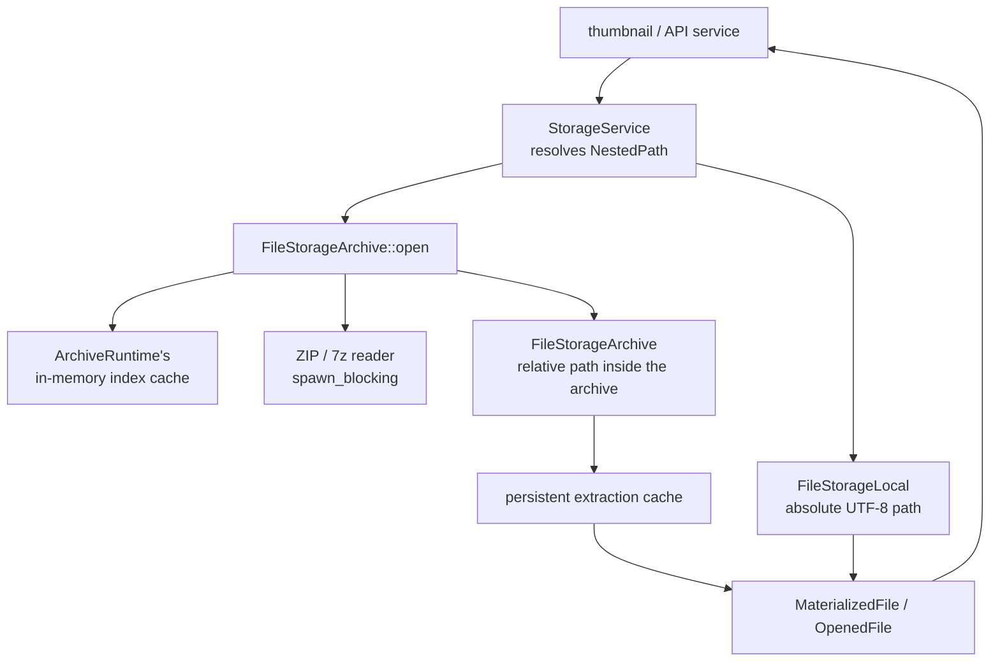
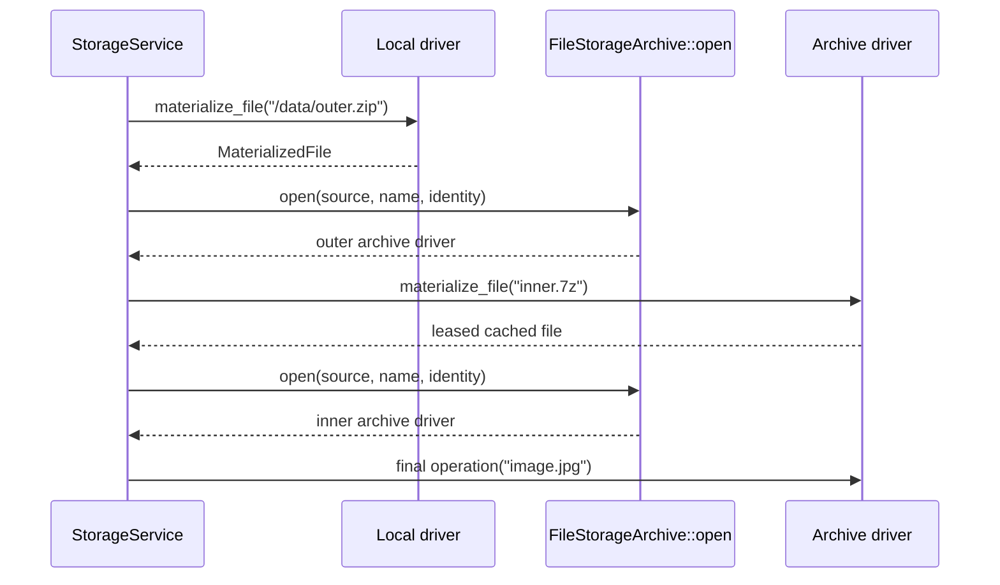

# Storage Layer Design

## 1. About This Document

This document covers the engine's storage service and local/archive storage, and defines responsibility boundaries, invariants, guarantees on failure, and the reasons for adoption.
The intended readers are developers and AI agents who implement or review this concern.
It assumes the vocabulary of [terms.md](../terms.md) and [terms/storage.md](../terms/storage.md).
The definitions of words are in those documents.

### 1.1 Division of Responsibility Between Documents

| Document | What it covers |
| --- | --- |
| This document | Design details, limits, reasons for adoption, and deferred items of the storage service and local/archive storage |
| [design.md](../design.md) | Pxna's overall scope, overall structure, boundaries between concerns, and cross-cutting design decisions |
| [terms.md](../terms.md) and [terms/storage.md](../terms/storage.md) | Definitions of overall and storage-specific terms |
| [issues.md](../issues.md) | Clear defects confirmed in code and handling policies |
| [daemon/openapi.yaml](../../daemon/openapi.yaml) | The authoritative HTTP API paths, schemas, and status codes |

The entry point of the design document family is [design.md](../design.md).

### 1.2 Tense of This Document

§1 through §9 describe the completed form in the present tense.
The gap between the current code and the completed form, and the remaining work in dependency order, are gathered in §10.
If you want to know what works now, read §10 first.

## 2. Responsibilities and Boundaries

This document covers the span from receiving a `NestedPath` to reading and writing the physical file.
It handles the host filesystem and read-only archives with the same driver contract, materializes only the archive entries that are needed, and hands them to higher-level features in the same way as local files.

The target archives are files the owner placed themselves.
Pxna's operating premise is "one server, one owner, on a LAN or over a trusted network", and it has no path for receiving archives from third parties ([design.md §2](../design.md#2-what-pxna-is)).
Even so, to protect the daemon from broken archives and extraction bombs, we limit the number of entries, path length, output volume, and nesting depth.

### 2.1 What Other Concerns Cover

| Matter | Authoritative source |
| --- | --- |
| The representation of `NestedPath` and the procedure for searching boundaries from the API's `RelativePath` | [design.md §4.3](../design.md#43-resolving-library-and-archive-boundaries) |
| How the API points inside archives and how it rejects changes | [design.md §8.6](../design.md#86-archives-and-readonly) |
| The semantics of tree-level copy and move, applying conflict per entry, and progress | [design.md §8.3](../design.md#83-conflict-policy) |
| The mapping from the engine's error kinds to HTTP status | [design.md §4.4](../design.md#44-error-model-and-http-mapping) |

This document covers only how to safely place one entry, and does not have tree walking or progress reporting.

### 2.2 What Is Not Built

- Creating, updating, deleting, and moving inside archives are not performed.
  This avoids having to rebuild a whole archive and repair midway failures.
- Archive parse and extract are not isolated into a separate process.
  This avoids having an IPC schema, a supervisor, and per-OS resource limit mechanisms.
  The cost and the conditions for deferral are recorded in §9.1 and §9.2.
- Password-protected archives are not decrypted.
  This avoids having a credential provider and a policy for decrypted caches.
- Archive formats other than ZIP and 7z are not handled.
  This avoids adding a reader per format to the initial implementation.
- Non-UTF-8 names of local paths are not handled.
  This avoids collisions from lossy conversion and mismatches in display names.
- Archive indexes are not persisted.
  This avoids having index schema migrations and consistency maintenance on source changes.
- Atomicity and rollback of a whole tree are not guaranteed.
  This avoids holding the destination tree twice and a cross-platform tree swap.
- The content hash of the whole source archive is not computed.
  This avoids the cost of reading the whole archive on first access.

## 3. Structure of the Storage Service and Drivers

### 3.1 Components

| path | package | Role |
| --- | --- | --- |
| [daemon/modules/engine/src/service/storage.rs](../../daemon/modules/engine/src/service/storage.rs) | `omnius-pxna-engine` | Resolving `NestedPath`, selecting a driver, moving between nested archives, cross-driver transfer |
| [daemon/modules/engine/src/core/nfs](../../daemon/modules/engine/src/core/nfs) | `omnius-pxna-engine` | The driver contract, local/archive drivers, materialization, caches |
| [daemon/modules/engine/src/model/nested_path.rs](../../daemon/modules/engine/src/model/nested_path.rs) | `omnius-pxna-engine` | The nested path representation used only by the service layer |
| [daemon/entrypoints/daemon/src/config.rs](../../daemon/entrypoints/daemon/src/config.rs) | `omnius-pxna-daemon` | Loading the `[storage.archive]` configuration and resolving relative Library paths |

### 3.2 Flow When Reading



The direction of dependency is one-way from `StorageService` to the storage primitives, and drivers know neither `NestedPath` nor the higher-level Library.

### 3.3 Resolution Order of Nested Archives



The next driver holds the intermediate archive's `MaterializedFile`, so entries being resolved or in use are not deleted by LRU eviction.
Each stage's identity is derived from the parent's identity, not from the physical path, so the inner cache survives even if the intermediate file's cache generation changes (§7.3).

## 4. Conventions for Paths and Entries

### 4.1 Local Paths

The outermost path entering `StorageService` is a UTF-8 absolute path.
A relative `libraries[].path` is resolved by the config layer against the config directory.
By the time the daemon layer passes it here, the Library boundary check and the archive boundary search are done ([design.md §4.3](../design.md#43-resolving-library-and-archive-boundaries)).

`canonicalize` is not required.
A copy destination whose source does not yet exist is handled with the same representation.

When a non-UTF-8 name is found in a directory listing, no lossy conversion or exclusion is done, and the whole operation becomes `InvalidInput`.

### 4.2 Decoding and Normalizing Archive Entry Names

An archive reader completes format-specific filename decoding within the reader.
A common `ArchiveEntryNameDecoder` and `ArchiveEntryId` are not provided.

7z always holds file names in UTF-16LE, so there is no decode branching.
ZIP has archives where general purpose bit 11 is not set, and decodes in the following order.

1. If it is valid as UTF-8, use it as is.
2. If not valid, decode the raw name bytes as the encoding given by the configuration value `zip_legacy_encoding` (the default is CP932).
3. If it contains a byte sequence that fails to convert, treat that entry as invalid.

Automatic detection of the encoding is not done.
If the detection result varied with the input, the normalized path would change and the `EntryCacheKey` would become unstable.

Unicode NFC/NFD normalization and case folding are not done.

The decoded name is normalized and validated in the following order.

1. Unify `\` to `/`.
2. Repeatedly remove a leading `./`.
3. Remove the trailing `/` of a directory entry.
4. Reject absolute paths, drive prefixes, empty segments, remaining `.` and `..` segments, and `NUL`.
5. Reject paths whose UTF-8 byte length exceeds 4096.
6. Reject entries that are empty after normalization.

If there is even one invalid entry, duplicate path, or kind collision, the entire archive fails instead of excluding the entry.
The error message includes the path of the entry that caused it.
Violations of the path length and entry count limits are `LimitExceeded`, and other structural violations are `InvalidFormat`.

### 4.3 Archive Root and Parent Directories

`""` inside an archive driver is a synthetic root directory.
`get_entry("")` returns a readonly directory, `find_entries("")` returns the root listing, and `exists_dir("")` returns `true`.

If `a/b/c.txt` exists and there are no parent directory entries, `a` and `a/b` are synthesized as readonly directories when the index is built.
The total entry count after synthesis must also be at most `max_entry_count`.
The count is checked on every insertion, including synthetic parents, so building the index never holds more than `max_entry_count` entries.
Synthesis walks each path's ancestors from the deepest one up and stops at the first existing one, so its work is proportional to the number of entries inserted, not to the square of the path depth.

### 4.4 Symlinks and Special Entries

How a symlink is handled depends on who placed it.

| Origin | Handling |
| --- | --- |
| A symlink on the local filesystem | Followed in content operations |
| A symlink entry inside an archive | Not followed; `UnsupportedType` |

The reason for drawing the line by origin and the rejected alternative are recorded in §9.1.

**What is followed is only a path directly named as the operation target.**
`get_entry`, `exists_file`, `exists_dir`, `open_file`, `read_file`, `materialize_file`, and a symlink given as the copy source look at the target.
On the other hand, a symlink found during the walk of `find_entries` is not followed and is returned as is as a link entry.
`find_entries(path, true)` also does not descend through links.
Descending would cause loops and duplicates, and the termination of the walk could not be guaranteed.

A listing returns a symlink as `FsEntryDetail::Link`.
The local driver puts the target obtained with `read_link` into `Some` as a raw string within the driver namespace, and sets `target_kind` to `None` if the target cannot be resolved as a file or directory.
A broken local symlink is also not silently excluded from the listing.
The archive index is built without extracting entry contents, so even if it recognizes a symlink by mode or reparse flag, the target is `None`.
No extraction path is provided just to obtain an archive symlink's target.

Drivers do not know Libraries, so interpreting this string as a Library-relative path and deciding whether to expose it to the API is up to the daemon layer ([design.md §11.1](../design.md#limit-the-library-boundary-check-to-client-input)).

Local sockets, devices, FIFOs, and the like are also `UnsupportedType`.
In listings and copies they are not silently excluded, and the operation fails on that entry.

### 4.5 FsEntry and Metadata

`FsEntry.path` is not the basename but the full path within the driver namespace.
The archive's `find_entries("a", ...)` returns `a/b.txt`, and a listing against a local absolute path returns absolute child paths.

The timestamps of `FsMetadata` are a best-effort `Option`.
A timestamp that the OS, filesystem, or archive format does not provide is `None`, and the mere absence of a timestamp does not fail a metadata operation.
An archive entry's `readonly` is always `true`.

A file entry carries a hint of whether that file is likely to be openable as an archive.
The hint is decided by the extension alone and does not read the contents.
When the listing target is inside an archive, settling by signature would require extracting each entry, and the basis of the determination would differ between inside and outside.
Whether it can actually be opened is decided when it is opened (§6.1).

## 5. Driver Contract

### 5.1 Read Operations

| Operation | local | archive |
| --- | --- | --- |
| `get_entry` | Returns OS metadata | Searches the validated index |
| `find_entries` | Walks the filesystem as a stream | Returns the prefix range of the index as a stream |
| `exists_file` / `exists_dir` | Determines the kind of the final entry | Determines the kind from the index |
| `materialize_file` | Returns a lease handle of the original file | Extracts the target entry or hits the cache |
| `open_file` | Common default implementation | Common default implementation |
| `read_file` | Common default implementation | Common default implementation |

`find_entries(path, false)` returns only direct children, and `find_entries(path, true)` returns all descendants.
Order is not part of the contract, and sorting is done by the display layer above the service.

`exists_file` and `exists_dir` return `false` only for non-existence, kind mismatch, and special entries.
Permission errors, I/O errors, archive anomalies, and source changes are returned as errors.

### 5.2 Default Implementations Centered on materialize

The central operation a driver implements is `materialize_file(&str) -> MaterializedFile`.
The trait's `open_file` opens the physical file after materialization to make an `OpenedFile`, and `read_file` seeks the `OpenedFile` and reads in pieces.

`read_file` exists for small reads inside the engine.
The limit per call is a fixed 64 MiB, `limit = 0` returns empty bytes, `offset >= EOF` also returns empty bytes, and the requested limit is never unconditionally allocated in one go.
A `limit` over the cap is `LimitExceeded`.
This is because silently truncating would make a caller mistake a short read for EOF.

**Large reads do not go through `read_file`.**
Reads with a large requested range, like an HTTP content response, consume `open_file` and reduce the range specification to a seek and a read length.
The daemon hands that content to the response body as a stream ([design.md §11.1](../design.md#return-file-content-responses-as-streams)).

`StorageService::resolve_entry` returns the resolved driver and the path within the namespace as a `ResolvedStoragePath`.
The caller uses this value for metadata, listing, materialization, and reading, and for searching a prefix of the same archive, only the path within the namespace changes.
The archive driver and the lease of the intermediate archive are kept for the lifetime of this value.
This is so that one request does not repeat the outermost fingerprint and cache lookup, and it does not become a cache spanning requests.
The driver continues to do the change check of the outermost file.

### 5.3 Write Operations and StagingFile

The archive driver implements the same mutation methods as local, but all return `ReadOnly`.
`StorageService` also rejects early once it knows the destination is an archive, and the driver defends as well.
No capability API for readonly determination is provided.

The write primitives a driver has are as follows.

```rust
async fn create_staging(&self, dst_dir: &str) -> Result<StagingFile>;
async fn make_dir(&self, path: &str) -> Result<()>;          // one level only
async fn remove_file(&self, path: &str) -> Result<()>;
async fn remove_dir(&self, path: &str) -> Result<()>;        // empty only
async fn rename(&self, src: &str, dst: &str, conflict: ConflictPolicy) -> Result<Publish>;  // within the same driver

impl StagingFile {
    async fn write_all(&mut self, buf: &[u8]) -> Result<()>; // append only
    fn len(&self) -> u64;
    async fn set_modified(&mut self, t: DateTime<Utc>) -> Result<()>;
    async fn publish(self, dst: &str, conflict: ConflictPolicy) -> Result<Publish>;
}

enum Publish {
    Published { dst: String },
    Skipped,
}
```

We chose `create_staging` as a primitive because an upload session performs the three stages of "create staging", "append", and "publish" across requests.
An `import_file` that composes them cannot represent a session's intermediate state.

Directory creation with `create_parents`, recursive deletion, and tree copy are not given to the driver.
Operations that need progress and cancellation are handled by the Operation layer (§8.2).

Random writes at a given offset are not provided.
A one-shot PUT writes the whole body to staging, and an upload session enforces `offset == committedSize` and always appends, so no path exists that overwrites the middle of an existing file.

A staging file is created in the same directory as the destination with the name `.pxna-tmp-<tsid>`.
This is so that a rename completes within the same filesystem even if a mount of a different filesystem exists inside the Library.
The name starts with a dot, and with the default `includeHidden=false` it does not appear in listings.

Reclaiming orphaned staging is opportunistic.
It deletes `.pxna-tmp-*` files that are not in the process's set of live staging and whose modification time is older than 24 hours.

The trigger for reclaiming is per Operation, and a tree copy or upload scans once per destination directory.
If it scanned every time a staging was created, then when copying many files into a folder with many entries, the number of scans would grow in proportion to the number of files.
It does not scan the whole Library at startup.
This is because startup would become slow on large trees.

Orphans left after a crash are reclaimed when the next Operation writes into that directory.

### 5.4 Error Model

The classifications that the storage design adds to the engine's `ErrorKind` are as follows.

| kind | Meaning |
| --- | --- |
| `ReadOnly` | A move whose destination is an archive or that includes an archive |
| `PasswordRequired` | An archive that cannot be inspected or extracted without a password |
| `LimitExceeded` | Exceeding a limit such as entry count, path length, output volume, size, or nesting depth |
| `Timeout` | An extract exceeded its deadline |
| `Cancelled` | Interrupted by the caller or by daemon shutdown |
| `SourceChanged` | The outermost source's fingerprint changed during processing |

For violations of the storage boundary's path contract, the existing `InvalidInput` is used.
Even with a dedicated kind it would fall to the same 400 in HTTP, so there is no practical benefit in separating them.

**There is a guarantee that `Timeout` cannot satisfy.**
Extract runs on `spawn_blocking`, so after the deadline passes the caller merely gives up, and the extraction processing itself does not stop.
What guarantees stopping is the output volume limits (`max_block_extract_bytes`, `max_materialized_file_size`), and `max_concurrent_extractions` is a limit so that processing that does not stop does not multiply.

The mapping to the API-side `ErrorKind` is authoritative in [design.md §4.4](../design.md#44-error-model-and-http-mapping).

## 6. Inspecting and Extracting Archives

### 6.1 Format Detection

The initial formats are ZIP and 7z.
A reader is selected by signature, not by extension.

An archive whose recognized extension and signature disagree is `InvalidFormat`, and an unknown signature is `UnsupportedType`.
Even when there is no extension or the extension is unknown, it can be processed if there is a supported signature.
An encrypted archive does not ask for a password and is `PasswordRequired`.

The archive hint in §4.5 is based on the extension, so a file may exist that cannot be opened even though the hint is `true`.
The hint is a clue for display, not a contract.

### 6.2 The Eager Archive Driver

`FileStorageArchive::open(source, name, identity, runtime)` looks up `ArchiveRuntime`'s index cache by identity, and merges the inspect on a cache miss and concurrent requests into a single-flight.
The driver it returns holds the validated `ArchiveIndex` and the source lease.
`name` is the logical path used to check the extension and signature, and for an inner archive, the inner path is passed, not the extensionless file in the extraction cache.

At the point the driver is successfully created, usability as an archive is settled.

### 6.3 Building and Validating the Index

Inspect cuts off the raw entry count at `max_entry_count`.
After that, it validates path normalization, duplicates, kind collisions, parent synthesis, and the total after synthesis.

Deterministic `UnsupportedType`, `InvalidFormat`, `PasswordRequired`, and `LimitExceeded` are negative-cached per identity only within the process.
I/O errors, timeouts, cancellation, and source changes are not negative-cached.

### 6.4 Block-Level Extract

Metadata, listing, and existence determination are handled by the index alone and do not extract contents.
The target is extracted only for `materialize_file`, `open_file`, and `read_file`.

**The unit of extract is the block, not the entry.**
The block the target entry belongs to is decoded exactly once, and every entry in that block is written to its own output.
The verified outputs are published or cleaned up depending on whether there is a cache.
This is because a solid 7z cannot decode from the middle of a block, and the reason for the choice and the rejected alternative are recorded in §9.1.

ZIP and non-solid 7z have only 1 entry per block, so the same path is the smallest-unit extract as is.
There is no branching on whether it is solid.

The unit of single-flight is also the block.
When different entries of the same block are requested at the same time, decoding is collapsed into one.

When the uncompressed total of a block exceeds `max_block_extract_bytes`, it is `LimitExceeded`.
There is no fallback to a sequential mode that decodes up to the target and discards.
Having a single path is the main advantage of choosing the block unit, and this is so as not to undermine it.
The user can open it by raising the configuration value.

When a single entry's size exceeds `max_materialized_file_size`, it is also `LimitExceeded`.

Timeline aggregation ([Timeline Design §6.2](./timeline.md#62-archive-extraction)) uses a path that extracts a block exactly once and receives all the requested entries that belong to that block, in order to read multiple entries in one archive together.
This path does not consult the extraction cache, does not publish, and runs the decoder with the concurrency limit the caller passes.
The extraction limits and deadline use the same values as `materialize_file`, and the output is handed over as a leased temporary file.
This is so that aggregation's extraction does not occupy the browsing concurrency budget or the extraction cache.

On the path that does not use the extraction cache, all entries in the block are output to individual OS temporary files, and only the requested entry is transferred to a leased `MaterializedFile`.
Sibling entries are not transferred even after verification, and, including outputs of failures and timeouts, they are deleted by dropping the temporary files.
On the path that uses the extraction cache, the verified entries in the block are published within the cache capacity.
If the whole block does not fit in the cache capacity, the requested entry is still reliably returned with a lease, and the rest are published only as far as capacity allows and the overflow is discarded.

The decoder runs on a blocking worker, and the worker itself holds the process-wide semaphore permit.
Even after the caller returns a timeout, the permit is not released until the decoder finishes, which prevents processing that cannot be stopped from slipping past the concurrency limit and multiplying.

When the format provides a CRC or digest, staging is published only after verification completes.
For formats without verification metadata, the condition for publication is that the decoder finished the whole entry normally.

### 6.5 Source Changes

Only the outermost local file has its fingerprint checked.
The inner archive's identity is derived from the parent's identity, so if the outer one changes, all inner identities change (§7.3).

The outermost archive driver checks the fingerprint before extract and before publishing to the cache.
On a mismatch it discards the staging and the processing result, and returns `SourceChanged` without automatic retry.

## 7. Configuration and Cache

### 7.1 Where the Configuration Belongs

The engine receives `ArchiveOptions` directly, and when the daemon wires `ArchiveRuntime` and `StorageService` at startup, it builds those values from the top-level `[storage.archive]`.
It is not mixed into `[core]`.

Byte sizes, counts, times, and parallelism allow only positive values, and `0` is not used to mean unlimited.
Validation of configuration values is done at daemon startup.

### 7.2 Defaults

| key | default | Applies to |
| --- | ---: | --- |
| `cache_capacity_bytes` | 10 GiB | File bytes of the persistent extraction cache |
| `index_cache_capacity_bytes` | 256 MiB | Approximate heap size of the in-process index cache |
| `max_nested_depth` | 4 | Number of archive boundaries |
| `max_entry_count` | 100,000 | Total of normalized entries and synthetic parents |
| `max_materialized_file_size` | 8 GiB | Output size of one target file |
| `max_block_extract_bytes` | 4 GiB | Limit for extracting one block in bulk |
| `extract_timeout_secs` | 300 | From the extract request to result validation |
| `max_concurrent_extractions` | 2 | Number of extracts running at once |
| `zip_legacy_encoding` | `cp932` | Decoding of non-UTF-8 ZIP entry names (`none` disables it) |

`max_nested_depth` has no fixed value with a basis.
Nesting increases the number of resolution stages and the materialization of intermediate files, so it means nothing beyond giving an upper bound by configuration to stop runaway behavior.

The following protocol limits are not made configurable.

| limit | value |
| --- | ---: |
| normalized archive path | 4096 UTF-8 bytes |
| `read_file` 1 call | 64 MiB |

### 7.3 Cache Identity

The cache identity is not built directly from the physical path and modification time.
This is because the substance of an inner archive is a file in the extraction cache, and both its path and its modification time change with cache generation turnover.

The identity is defined as follows.

```text
ArchiveIdentity(local)    = H(CACHE_FORMAT_VERSION, "local", abs_path, size, mtime_s, mtime_ns)
ArchiveIdentity(nested)   = H(CACHE_FORMAT_VERSION, "nested", ArchiveIdentity(parent), inner_path)
EntryCacheKey(archive, e) = H(CACHE_FORMAT_VERSION, "nested", ArchiveIdentity(archive), inner_path(e))
```

`H` is SHA3-256, and each field is serialized with its length prepended.
`inner_path` is the path normalized in §4.2.

The fingerprint of the outermost local file consists of the byte size and the modification time in seconds and nanoseconds, and is used to detect source changes during processing (§6.5).
A change that was deliberately restored to the same size and modification time cannot be detected.

`ArchiveIdentity(nested)` has the same value as the `EntryCacheKey` that extracts that archive from its parent.
The identity and the cache key can be computed with the same function.

The following follows from this definition.

- Even if the intermediate archive's cache file is swapped, the inner identity does not change
- If the outermost local file changes, all inner identities change. There is no need to check the fingerprint at intermediate layers
- The keys of the index cache, the negative cache, and single-flight can be unified under the same identity
- Caches outside storage can also point to an entry in an archive by `EntryCacheKey`. The thumbnail cache and media info use this ([Thumbnail Design §8.3](./thumbnail.md#83-keys))

The cost is that if the outer archive is rebuilt with the same contents, the modification time changes and all inner caches miss.
This is a trade-off with the policy of not taking a content hash of the whole archive (§2.2).

If filename decoding, path normalization, extract semantics, or validation conditions are changed, raise `CACHE_FORMAT_VERSION`.
Old versions are a miss and are subject to ordinary cleanup.

### 7.4 Placement of the Extraction Cache

The persistent cache has the following layout.

```text
state_dir/storage/archive/
├── cache.sqlite3
├── files/
│   └── ab/
│       └── ab...<EntryCacheKey>
└── staging/
```

`files` is split into 256 directories by the first 2 hex digits of the `EntryCacheKey`.
The raw archive path and raw entry path are not used in file names.

A SQLite row stores both the key and the original fields, and a match is checked at lookup.

When initializing the cache fails (migration failure, corruption, reconciliation failure), `storage/archive/` is deleted entirely and recreated, and it tries once more.
If the second attempt also fails, the daemon's startup fails.
The cache's contents are regenerable and not user data, so being unable to start because of one corruption is not worth it.
On the other hand, a state where even recreating fails is a state where the state directory itself is not writable, and the thumbnail cache that uses the same directory does not work either.

When corruption is detected while running, only that operation fails.
It is not automatically recreated.
This is because it would take down entries under lease with it.

### 7.5 LRU and Leases

The persistent extraction cache has no TTL and deletes entries starting from the oldest `last_accessed`.
A cache hit updates `last_accessed`.

Entries under lease are excluded from eviction.
Even if all candidates are under lease, it neither waits nor errors, and returns the new materialization as a lease-only temp.

Even when a single entry exceeds the cache capacity, if it can be extracted within the limits, it is not cached and becomes a lease-only temp.

### 7.6 Publishing and Reconciliation

The extract output is written to a unique path under `staging/`.
Before publishing, the completion state, integrity, actual size, file kind, and fingerprint are verified, and it is registered into the cache by an atomic rename within the same filesystem and a SQLite update.

There is no atomicity spanning a filesystem rename and a SQLite transaction, so the leftover of only one side after a crash midway is reclaimed by startup reconciliation.
Reconciliation deletes remaining staging, rows without files, and files without rows.

Even if only cache registration fails, as long as the verified staging remains, processing succeeds as a lease-only temp.
A failure of the extract or staging write itself is an operation error.

A cache published before a daemon crash is reused after restart.

### 7.7 Index Cache

The archive index is an in-process-only LRU cache that holds `Arc<ArchiveIndex>` keyed by `ArchiveIdentity`.
The first access after a daemon restart inspects again.

The cache merely drops the `Arc` of an LRU entry, and an index held by a driver stays alive.
`index_cache_capacity_bytes` is an upper bound on the approximate amount the cache holds, and not a strict memory limit for all active drivers.

When a single index exceeds the capacity, it is used by the current driver but not registered in the cache.
It does not wait for the release of an index in use.

## 8. Copy and Move

### 8.1 Permitted Directions

| source | destination | copy | move |
| --- | --- | --- | --- |
| local | local | Allowed | Allowed |
| archive | local | Allowed | `ReadOnly` |
| local | archive | `ReadOnly` | `ReadOnly` |
| archive | archive | `ReadOnly` | `ReadOnly` |

A cross-driver copy is composed by `StorageService` from the source's `OpenedFile` and the destination's `StagingFile`.
The archive driver's own mutations and a move that includes an archive are `ReadOnly`.

### 8.2 Division of Responsibility

| Layer | What it has |
| --- | --- |
| driver | Primitives for one entry: `create_staging`, `make_dir`, `remove_file`, `remove_dir`, `rename` |
| `StorageService` | Resolving `NestedPath`, selecting a driver, a cross-driver transfer of one file, delegating the walk stream |
| The daemon's Operation layer | Walking trees, applying conflict per entry, updating progress, cancellation, collecting failed entries |

Tree processing is not placed in the driver because the API's `Operation` reports per-entry progress and failures and accepts cooperative cancellation.
These cannot be extracted from a form that processes the whole tree in a single call.

Only conflict resolution is kept on the driver side.
`Rename` needs exclusive creation to secure a candidate, and "check existence and then create" at a higher level would be a TOCTOU.

The semantics at the tree level (merge, kind conflicts, partial success) are authoritative in [design.md §8.3](../design.md#83-conflict-policy).

### 8.3 Publishing a File and Resolving Conflicts

Regardless of whether the source is local or an archive, publishing a file chunk-copies into a `StagingFile` in the same directory as the destination, sets the contents and an optional `modified` timestamp, and then calls `publish`.

`publish` applies `ConflictPolicy`.

- `Fail` returns `AlreadyExists` if the destination exists
- `Skip` returns `Skipped` if the destination exists, and does not touch the existing one
- `Overwrite` replaces it with the OS's atomic replace primitive
- `Rename` secures a non-conflicting name by exclusive creation and returns the actual path

**`Fail`, `Skip`, and `Rename` use the OS's no-replace rename.**
An ordinary rename silently replaces an existing destination, so if existence checking and renaming are separated, when the destination is created in between, what should have been `Fail` becomes an overwrite.
Linux uses `renameat2(RENAME_NOREPLACE)`, macOS uses `renameatx_np(RENAME_EXCL)`, and Windows uses `MoveFileExW` without passing `MOVEFILE_REPLACE_EXISTING`.
Only in environments that return `ENOSYS`, `EINVAL`, or `ENOTSUP` (old kernels, filesystems that do not support no-replace rename) does it fall back to the two stages of an existence check and a rename.
A window for races remains only on this fallback path.

`Overwrite` uses an ordinary rename because replacement itself is the purpose.

`Rename` makes candidates for `photo.jpg` in the order `photo (1).jpg`, `photo (2).jpg`.
A directory is `folder (1)`, a dotfile is `.profile (1)`, and past 10,000 candidates it is `LimitExceeded`.

A destination symlink is not treated as its link target.
`Overwrite` does not follow the link target and atomically replaces the link entry itself.

On failure, timeout, and cancellation, the staging is deleted.
Even with `Overwrite`, the existing destination is not deleted first, so no gap is created in which half-finished contents are visible.
If the OS cannot complete the atomic replacement of an existing destination, the existing destination is kept and it becomes an error.

Permissions, created/accessed timestamps, owner, ACL, xattr, and resource forks are not carried over.
An archive's readonly metadata is also not carried over to the destination.

When different source names correspond to the same destination on a case-insensitive filesystem, no special handling is done.
The file published first exists, so the four policies behave correctly as they are.

### 8.4 Move

A move between locals first tries the OS rename.
Only when the rename fails with something equivalent to `EXDEV` does it fall back to the method of deleting the source after the copy completes.
`StorageService` makes this decision.

If the file copy fails, the source is kept.
If deleting the source after a successful copy fails, both the source and the destination are left and an error is returned, and no rollback of the destination is done.

Atomic move is guaranteed only when the OS rename succeeds.

## 9. Design Decisions

### 9.1 Decided

#### Limit NestedPath Resolution to the Service Layer

**Decision**
Only `StorageService` resolves `NestedPath`, and drivers receive only a `&str` within a bound filesystem.

**Reason**
It does not leak the assembly of archive paths and inner paths into every driver method, and keeps the local and archive contracts at the same granularity.

**Rejected alternative**
A `FileStorage` dispatcher that tries multiple drivers in turn and moves to the next on `UnsupportedType`.
Driver selection and the actual entry kind error become the same error, and the responsibility for nested traversal also becomes ambiguous, so we rejected it.
The previous implementation took this form.

#### Run the Archive Library in the Same Process as the Daemon

**Decision**
Inspect and extract run on `spawn_blocking`, and there is no isolation into a separate process, no IPC, and no OS resource limits.
Safety is ensured by limits on entry count, path length, output volume, nesting depth, and concurrency.

**Reason**
Pxna's archives are files on the owner's own disk and there is no path for receiving them from third parties ([design.md §2](../design.md#2-what-pxna-is)).
What process isolation protects against is the spread from decoders that cannot be stopped and from memory corruption, but its price is an IPC schema, code generation, a supervisor, kill and reap, and per-OS resource limit mechanisms.
For a single-owner LAN daemon where a restart is not catastrophic, this price is not commensurate.
What we gave up is recorded as a deferred item in §9.2.

**Rejected alternative 1**
Isolation with a one-shot child process and length-prefixed IPC.
In addition to the price above, since it does not block file access by the same OS user, it remains incomplete as a security boundary.

**Rejected alternative 2**
A resident worker pool.
It would carry process state corruption from one archive over to the next request, and the lifecycle and recovery become complex, so we rejected it.

#### Extract per Block

**Decision**
The unit of extract is the block, not the entry. The block the target entry belongs to is decoded once and all entries it contains are output individually.
The verified outputs are published or cleaned up depending on whether there is a cache.

**Reason**
A solid 7z cannot start decoding from the middle of a block.
Per entry, the output before the target would be discarded every time, and the amount extracted would be proportional to the square of the number of entries.
Merely listing an archive of 300 entries would extract 150 times the uncompressed size.
Per block, the amount extracted is proportional to the number of entries.
Furthermore, ZIP and non-solid 7z have only 1 entry per block, so branching on whether it is solid is itself unnecessary.

**Rejected alternative 1**
Extracting per entry and decoding while discarding the prefix only for solid ones.
There would be two paths and the quadratic cost above would remain, so we rejected it.

**Rejected alternative 2**
Not supporting solid 7z.
Whether it is solid is known from header analysis alone, so it is easy to implement, but 7-Zip's default is solid and it would reject most real `.7z` files, so we rejected it.

#### Per-Entry Materialization and Leases

**Decision**
Only the content that is accessed is materialized, and the physical path and lifetime are bundled into a `MaterializedFile`.

**Reason**
While avoiding extracting a whole archive, files in use can be protected from LRU and from deletion races on Windows.

**Rejected alternative**
Always extracting and caching a whole archive.
The disk usage of a single access is large and the units of eviction and failure cleanup become coarse, so we rejected it.

#### Explicitly Reject Archive Mutation

**Decision**
The archive driver implements the same interface as local but returns `ReadOnly` for mutations.

**Reason**
It does not make higher layers branch per source format, and avoids the corruption risk of rebuilding archives.

**Rejected alternative**
Per-capability traits that remove the mutation methods from the archive driver.
It would increase type branching on the caller side and capability negotiation, so we do not adopt it in the initial implementation.

#### Limit Drivers to Primitives for One Entry

**Decision**
Drivers have only operations that target one entry, and do not have tree walking, progress reporting, cancellation, `create_parents`, or recursive deletion.
Writing is consolidated into the `StagingFile` that `create_staging` returns.

**Reason**
The API's `Operation` reports per-entry progress and failures and accepts cooperative cancellation.
These cannot be extracted from a driver method that handles a whole tree in a single call.
We made `create_staging` a primitive because an upload session performs the three stages of writing across requests.

**Rejected alternative 1**
Giving the driver `copy_dir` and `move_dir`, and passing a progress sink and a cancellation token as arguments.
The driver contract becomes heavy and the responsibility for cross-driver copy remains ambiguous, so we rejected it.

**Rejected alternative 2**
Making `import_file(OpenedFile, dst, conflict)` the primitive.
It is enough for one-shot PUT and copy, but cannot represent the intermediate state of an upload session, so we rejected it.

#### Follow Local Symlinks and Do Not Follow Symlinks Inside Archives

**Decision**
Symlinks on the local filesystem are followed in content operations, and symlink entries inside archives are `UnsupportedType`.
What is followed is only a path directly named as the operation target, and we do not descend into symlinks found during the walk.

**Reason**
Only the owner can place symlinks on the file system, and the API has no path to create symlinks.
Archives, on the other hand, can be supplied by clients through the upload API.
Drawing the line by origin keeps the real-world configuration of a Library bundling external disks with symlinks while stopping following from untrusted input.

On the premise of this decision, the judgment to limit the Library boundary check to the `..` and absolute paths the client sent holds ([design.md §11.1](../design.md#limit-the-library-boundary-check-to-client-input)).

**Rejected alternative 1**
Not following symlinks at all.
Configurations such as a symlink from `~/Pictures/2026` to an external disk could no longer be browsed, so we rejected it.

**Rejected alternative 2**
Following only when the target can be resolved inside the Library.
The configuration pointing to an external disk is exactly outside the Library, and the main use could not be saved, so we rejected it.

#### A Persistent LRU Cache and an Identity Derived from the Chain

**Decision**
Extracted files are placed in a persistent LRU cache with SQLite metadata.
The identity is built from the path and fingerprint of the outermost local file, and the inner ones are derived from the parent's identity and the inner path.

**Reason**
Expensive extracts can be reused even after a daemon restart.
Extracting nested archives is especially expensive, so the value of reuse is large.
By deriving the identity from the parent, the inner cache survives even if the intermediate file's cache generation changes.

**Rejected alternative 1**
Building the inner identity from the physical path and modification time.
The intermediate file is swapped at each cache generation turnover, so the inner cache does not survive across restarts and the purpose of persistence is not served.

**Rejected alternative 2**
An in-process LRU and a disk cache with session lifetime.
SQLite, migrations, and reconciliation become unnecessary, but the extraction cost of nested archives would be paid at every restart, so we rejected it.

**Rejected alternative 3**
TTL eviction.
Useful entries would disappear by elapsed time rather than frequency of use, so we rejected it.

**Rejected alternative 4**
A content hash of the whole source archive.
It would incur the cost of reading a whole large archive every time for cache lookup, so we rejected it.

#### Validate Archive Paths Strictly

**Decision**
An archive containing even one unsafe or unrepresentable entry is rejected as a whole, with no lossy conversion or partial exclusion.
Duplicate paths and kind collisions are handled the same way.

**Reason**
This is to prevent listings and directory copies from becoming silently incomplete, and path collisions after normalization.
The determination is deterministic, so the negative cache works and the second and later times cost nothing.

**Rejected alternative**
Resolving duplicate paths last-wins.
It matches the convention of `unzip` and similar, but the entry that appeared first silently disappears from listings, so we rejected it.

#### Decode Non-UTF-8 ZIP Names as CP932

**Decision**
A ZIP entry name that is not valid as UTF-8 is decoded as the configuration value `zip_legacy_encoding` (default CP932).
Automatic detection of the encoding is not done.

**Reason**
ZIPs created on Windows in Japanese environments do not set general purpose bit 11, and names are stored in CP932.
If only UTF-8 were handled, not a single file of this kind of archive could be opened.
We avoid automatic detection because if the detection result varied with the input, the normalized path would change and the `EntryCacheKey` would become unstable.

**Rejected alternative**
Using a library that automatically detects character encodings.
In addition to the cache key instability above, the same archive could return different paths depending on the library's version, so we rejected it.

#### Atomic Publish per File

**Decision**
A file is published by rename from staging in the same directory as the destination, and atomicity of any larger unit is not guaranteed.

**Reason**
This prevents midway destruction of existing files while avoiding doubling the capacity of the whole tree, a cross-platform swap, and rollback.
We do not put staging in an area common to the Library because if a mount of a different filesystem exists inside the Library, the rename becomes `EXDEV`.

**Rejected alternative**
A method that builds the whole directory in a sibling staging tree and swaps in one go.
It is hard to reconcile an `Overwrite` merge with preserving the existing tree, and failure recovery also becomes complex, so we rejected it.

<a id="local-listing-batches"></a>
#### Batch Local Attribute Fetching and Limit the Processing of the Shared Driver

**Decision**
The local walk fetches the attributes of enumerated paths on blocking tasks, up to 64 at a time. One stream can have at most 2 batches ahead, and the shared local driver has at most 4 batches running.
At most 16 streams can enter enumeration and attribute fetching at once, and calls beyond that wait with await without creating additional batches. The attribute-fetch targets each stream holds ahead are at most 128 paths, and if the consumer stops, it does not enumerate further.
This budget is not an upper limit on accepting HTTP requests themselves. The callers' waiting futures, the check of the first root, search targets held in recursion, and other storage operations are outside this batch limit.
The priority allocation with the background is handled by a separate cross-cutting budget, and this limit alone is not taken to guarantee foreground priority.

When a stream is dropped, cancellation is notified. The worker checks the notification before each Entry, and does not forcibly stop a system call that has already started. The worker's permit is held until the processing actually finishes.
The conventions for attributes, symlinks, and special Entries, and the error classification, follow §4. Order is outside the driver contract, but completed batches are consumed in enumeration order.
The sum of the attribute times of parallel batches includes overlap, so it is recorded separately from the stream's elapsed time.

**Reason**
It reduces round trips to a blocking task per Entry, and overlaps attribute waits with a small number of workers.
The shared limit and backpressure to the consumer prevent many requests or a slow consumer from continuing to pile work onto the blocking pool.
A blocking task that has started cannot be interrupted, so the cancellation check and the permit's lifetime are aligned with the actual processing.

**Rejected alternative**
A method that creates tasks for all Entries first. It increases unfinished work in proportion to the count and the number of requests, so we do not adopt it.

<a id="listing-work-budget"></a>
#### Reserve Separate Execution Slots for Foreground and Background Enumeration

**Decision**
Work belongs to one of three classes: Interactive (the one item the user waits for now, such as the display image shown in the viewer), Foreground (listings, search, and grid thumbnails), and Background (the timeline and child probes).
Each resource is one pool of a single scheduler. A pool has shared slots for Interactive and Foreground, slots only Interactive uses, and slots only Background uses.
Foreground does not start while Interactive runs or waits in the same pool. Background does not start while Interactive or Foreground runs or waits in any pool. Work that started is not stopped, and within a class work starts in arrival order.
Interactive and Foreground never wait for a Background slot, so Background work that holds one pool while it waits for another does not stall them.
The pools are the listing workers and the listing streams below, image conversion, and ffmpeg and heif-dec runs ([Thumbnail Design §7](./thumbnail.md#7-order-and-concurrency-of-generation)).
While a video segment the player waits for is not yet written, and while the media info of an opened file is read, the ffmpeg pool counts Interactive work without using a slot.
The child processes that Background work starts run with nice 10.

Across all Libraries and all requests of the same local driver, the attribute-fetch batches of listings, the batches of name enumeration, and the leaf attribute fetches of detail fetching are summed. 3 shared slots and 1 Background slot are reserved, for a total of at most 4 slots.
The background slot is also shared with the timeline's local enumeration, fetching dates and probes from contents, background extraction of archives, and serialization and persistent writes of the browse index. The same slot is not acquired in a nested way, and is returned at the boundaries of enumeration, extraction, and content reading.
The maximum of 4 items of a detail batch is the number of items admitted including boundary resolution, and is not a slot that adds 4 more local attribute workers. A leaf's attribute fetch is included in the same 3 foreground slots as an ordinary listing, and resolution processing that took an item slot does not preempt the foreground attribute slot, and acquires it only for the leaf's processing.
A batch is at most 64 Entries, the stream admission slots are reserved as 12 shared and 4 Background for a total of 16, and each stream's prefetch is at most 128 items. Background admission waits do not fill the shared stream slots. Background processing yields at the boundary of a batch or of one file or one block.
The background acquisition order is the shared background slot, then the processing's existing probe, extraction, and DB-write exclusion. It does not hold in the reverse order and wait for the background slot. Before moving to the next processing unit, both are returned, and the same background slot is not reacquired internally while held.
Probing for whether there are children tries the background slot and the background stream slot only when neither the normal background workers nor streams have waiters, and returns unconfirmed if it cannot get them.

What this budget limits is the processing units above, and it does not limit HTTP acceptance, admission-waiting futures, stat of the root, search targets of recursion, or all I/O of writes and file delivery to 4.
The archive's process-wide extraction slot and the slots of video transcoding keep their existing separate budgets. Limits on different resources are not reported as the same counter.
max_concurrent_probes and max_concurrent_extractions are additional limits on the background side and do not increase the shared background slot. Even with multiple Libraries, heavy background processing is limited to 1 unit at a time.
It does not forcibly stop blocking processing that has started, and even after cancellation it holds the slot until actual termination. That waiters alone do not keep increasing is verified together with the existing stream admission slots.

**Reason**
In a measured session, the wait of display images for a generation slot behind tile generations and abandoned display requests reached 35 s, while one ffmpeg decode of a HEIC file took 2.7 to 15.5 s.
Holding the lower classes keeps the CPU for the item the user waits for, and the separate Background slots keep the timeline's load from filling the shared slots.
Background does not progress while the user keeps browsing, which is accepted for a personal server whose browsing sessions are limited.
The cost of limiting to 3 slots even when there is only the foreground is confirmed by comparison with the 4 slots of phase one. Interruption of heavy processing in progress is not guaranteed, and is controlled before moving to the next unit.

### 9.2 Deferred

#### Process Isolation for Archive Handling

**Current state**
Inspect and extract run on `spawn_blocking` in the same process as the daemon.
If a decoder that cannot be stopped is hit, one blocking thread is occupied, and `max_concurrent_extractions` stops multiplication but does not release it.
Memory corruption spreads to the whole daemon process.

**Why not decide now**
Under the current operating premise, archives are the owner's own files, and the price of isolation (an IPC schema, code generation, a supervisor, per-OS resource limit mechanisms) is not commensurate.

**Conditions for deciding**
When starting operation that receives archives from untrusted third parties, or when a daemon stop caused by archive processing is actually observed.

#### Password-Protected Archives and Decrypted Caches

**Current state**
A password-protected archive is `PasswordRequired`, and the password is not passed to the driver API.

**Why not decide now**
Storing credentials, who prompts, and whether decrypted files may be kept in a persistent cache need to be decided together.

**Conditions for deciding**
When adding browsing of password-protected archives to product requirements.

#### Legacy Encodings Other Than CP932

**Current state**
A non-UTF-8 ZIP entry name is decoded as the single encoding of `zip_legacy_encoding`, and the default is CP932.
There are no multiple candidate encodings.

**Why not decide now**
With multiple candidates, the normalized path would change depending on which one was adopted, and a separate rule to keep the `EntryCacheKey` stable would be needed.

**Conditions for deciding**
When actually adding archives created in legacy encodings other than CP932 to the supported targets.

#### Archives That Hit the Block Bulk-Extraction Limit

**Current state**
It extracts per block, and an archive whose block uncompressed total exceeds `max_block_extract_bytes` cannot be opened, with `LimitExceeded`.
There is no sequential fallback.

**Why not decide now**
We have not measured how many archives that hit the limit appear in real operation, or whether switching to partial extraction is worthwhile.

**Conditions for deciding**
When exceeding `max_block_extract_bytes` with the default value frequently occurs on real data.

#### Strict Daemon-Wide Memory Admission

**Current state**
The index cache gives an upper bound with an approximate LRU, but the total amount of indexes held by active drivers is not limited.

**Why not decide now**
A strict limit would need request admission, the number of active leases, and an integrated memory budget including the daemon's other features.

**Conditions for deciding**
When memory pressure on the daemon from the number of active archives is observed, or when the daemon-wide memory budget is made a requirement.

## 10. Current State and Remaining Work

### 10.1 Current Code

The priority rule is owned by [schedule.rs](../../daemon/modules/engine/src/core/schedule.rs). [WorkBudget](../../daemon/modules/engine/src/core/work.rs) holds the listing worker pool with 3 shared and 1 Background slot, and the stream pool with 12 shared and 4 Background slots. When the daemon is constructed, the same budget is passed to the local driver, the archive runtime, the timeline, and the browse index. Name enumeration and attribute fetching acquire slots 64 items at a time and hold them until the blocking worker actually finishes. Child probes try both slots only when neither the normal background workers nor streams have waiters.

The driver contract has the shape of §5.
`FileStorageDriver` receives a `&str` within the bound namespace in all methods, and `FsEntry.path` is a `String`.
`FsEntryDetail::Link.target` is an `Option<String>`, and the local driver returns the target it could read as `Some`, and the archive driver returns the target it does not fetch as `None`.
For reading, `get_entry`, `find_entries`, `exists_file`, `exists_dir`, and `materialize_file` are required, and `open_file` and `read_file` are default implementations on top of `materialize_file`.
Writing is only the 5 operations `create_staging`, `make_dir`, `remove_file`, `remove_dir`, and `rename`.

`MaterializedFile`, `OpenedFile`, `ConflictPolicy`, and `StagingFile` are implemented.
There are three kinds of `MaterializedFile` lease: "a no-op pointing to the original file", "deletes the temp on drop", and "excludes an extraction cache entry from eviction".

`FileStorageLocal` works according to the symlink conventions of §4.4 and the conflict conventions of §8.3.
The `FileStorage` dispatcher has been deleted, and `StorageService` is exposed from `service.rs`.
`StorageService` resolves `NestedPath` in order from the outside, and makes mutating operations at rank 1 or higher `ReadOnly`.
The outermost archive checks the source's fingerprint before extract and before registering into the cache, and returns `SourceChanged` if it changed.
`ThumbnailGenerator` reads images and videos from `StorageService` and points to entries in archives by `EntryCacheKey` ([Thumbnail Design](./thumbnail.md#83-keys)).

Orphaned staging is reclaimed by `sweep_staging`.
Single-file writes and Uploads call it before creating staging, and Operations call it once per destination directory.

`ArchiveOptions`, `ArchiveRuntime`, and the readonly `FileStorageArchive` are implemented.
ZIP and 7z eagerly build a validated index and answer metadata, listing, and existence determination from the index alone.
Materialization extracts the block the entry belongs to on a blocking worker, registers all the files in the block whose sizes were verified into the persistent extraction cache, and returns the requested file with a lease.
Concurrent requests to the same block are collapsed into one decode by single-flight.
The result of inspect is held by the in-process index cache per `ArchiveIdentity`, and results where it was determined that it cannot be opened as an archive are negative-cached.
The old `local_archive` module has been deleted.

The engine depends on `async_zip`, `sevenz-rust2` 0.22.0, `encoding_rs`, `sqlx`, `tempfile`, and `sha3`.
For no-replace rename, it depends on `rustix` on unix and `windows-sys` on Windows.

The archive foundation has passed CI verification on Linux, macOS, and Windows.
`test-daemon-all` can also be run by workflow_dispatch, and on Linux it verifies all tests including Docker, and on macOS and Windows it verifies excluding only the PostgreSQL Docker tests.

`ErrorKind` has the 6 kinds of §5.4.
The daemon configuration has `core`, `logging`, `libraries`, and `[storage.archive]`.
At startup the daemon opens the extraction cache at `state_dir/storage/archive/` and passes `ArchiveRuntime` to `StorageService`.
The daemon's reads, thumbnails, and mutations are connected to `StorageService`.
The resolved namespace is held as a `ResolvedStoragePath`, and the driver and lease are reused across entry, listing, and materialization.

The path that extracts blocks together (§6.4), which timeline aggregation uses, is `block_groups` and `extract_group` of `FileStorageArchive`.
It does not consult the extraction cache, runs the decoder with the semaphore the caller passes, and the temporary files it has finished reading are deleted when the lease is dropped.

The actual empty places can be found with `rg 'todo!' daemon/modules/engine/src`.

The shared slots and batch processing of local attribute fetching are owned by [local/listing.rs](../../daemon/modules/engine/src/core/nfs/driver/local/listing.rs).
The enumeration in [local.rs](../../daemon/modules/engine/src/core/nfs/driver/local.rs) prepares at most 128 paths to match the consumer, and on cancellation the worker stops moving to the next Entry.

### 10.2 Roadmap

The order is provisional.
Only the dependencies must be respected.

| No. | Content | Dependencies assumed | State |
| --- | --- | --- | --- |
| N1 | Settle the driver contract including `String` paths, `MaterializedFile`, `OpenedFile`, `StagingFile`, and error kinds | None | Done |
| N2 | Implement ZIP inspect, the CP932 fallback, path normalization, the flat index, and extract | N1 | Done |
| N3 | Implement 7z inspect and block-level extract | N2 | Done |
| N4 | Implement the in-memory index cache and the persistent leased extraction cache | N2, N3 | Done |
| N5 | Implement `StorageService`'s `NestedPath` resolution, the archive factory, and source change detection | N1, N2, N3, N4 | Done |
| N6 | Connect the daemon layer's boundary detection, the local/archive drivers, and the thumbnail consumer to `StorageService` | N5 | Done |
| N7 | Verify path, ZIP, 7z, block, limit, timeout, LRU, lease, reconciliation, single-flight, and transfer per platform | N1 through N6 | Done |

The archive factory of N5 is not an independent type, and `FileStorageArchive::open`, which receives `ArchiveRuntime`, takes that role.

For confirmed defects, see [issues.md](../issues.md).
